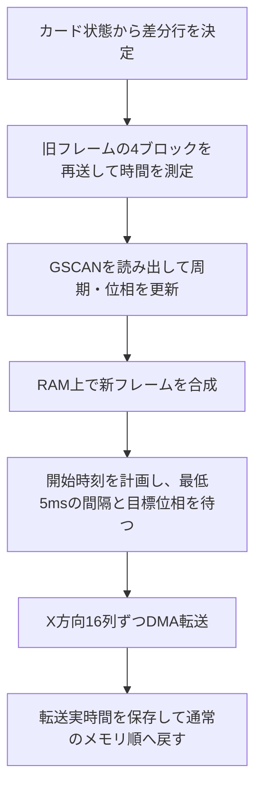

# プレイヤーノードの実装詳細

## タスク構成

ESP32-S3のデュアルコアとArduino環境のFreeRTOSを利用し、[game.hpp](../../src/player/game.hpp)と[drawing.hpp](../../src/player/drawing.hpp)で更新と描画を別コアに分離している。

| 処理 | 担当 | 所有する状態 |
| --- | --- | --- |
| ゲーム更新 | Arduinoの`setup()` / `loop()` | `PacketQueue`、`PacketAnimation`、デモ、スコア、残り時間、自ノードID |
| LCD描画 | `display_task` | LCD、合成スプライト、`PacketRenderer`、ソフトウェアTEの状態 |

描画タスクは優先度1、スタック4096Bで作成し、`DISPLAY_CORE = 1 - ARDUINO_RUNNING_CORE`でArduinoタスクと反対側のコアへ配置する。通常の設定ではゲーム更新がコア1、LCD描画がコア0となる。描画側がDMA完了や走査位相を待っている間も、別コアのゲーム更新は進められる。

ゲーム側は16ms以上経過するとアニメーションを更新し、`DisplaySnapshot`を発行する。スナップショットにはカード4件、スコア、残り時間、自ノードIDを格納する。FreeRTOSがバイトコピーできる型であることを`static_assert`で確認している。

受け渡し用のFreeRTOSキューは長さ1で、`xQueueOverwrite()`により未処理の古いスナップショットを最新値で置き換える。描画が追いつかない場合に中間フレームを省略し、古い表示要求を蓄積しない。ゲーム側は描画完了を待たず、描画側はキューが空なら`xQueueReceive(..., portMAX_DELAY)`で待つ。

したがって、更新側は描画処理に対して待ち合わせをしないが、LCD側の処理にはDMA完了待ちと位相待ちがある。16msは更新の目標間隔であって、実表示の62.5FPSを保証する値ではない。アニメーションは実経過時間で進めるので、表示フレームが省略されても時間軸は維持する。

描画タスクは起動表示、固定レイアウト、GSCANの初期推定を済ませてから、ゲーム側へタスク通知を送る。パケットデモのpop/pushタイマーはこの通知を受けて開始する。

## MCUでの描画用パケット管理

[packet.hpp](../../src/player/packet.hpp)の`Packet`は、`uint16_t id`と`NodeId destination`のみを持つ

`PacketQueue`は容量1024件固定のFIFOリングバッファとして扱う。

キューを変更するのはゲーム側のタスクだけとし、描画側にはコピーしたスナップショットを渡す。`PacketQueue`自体には現時点では複数タスク向けのロックを持たせていない、今後追加する通信タスクとの兼ね合いとなるだろう。

## LCD

### 構成と配線

- MCU: ESP32-S3
- LCD: ST7796S SPI接続 4.0" IPS 回転前解像度320×480 (横向き480×320で使用した)
- 描画ライブラリ: LovyanGFX (RGB565・16bit/pixel)
- 書き込みは SPI 80MHz で行っていて、ユニバーサル基板、線長約10cmの配線での動作を確認できている(動作を保証する文言ではない)。
- 当該ディスプレイアセンブリにはTE信号線が出ていなかったため、GSCAN命令(0x45)によるソフトウェアTEを実装しティアリングの軽減を行っている。ただしあらゆる条件下で完全にティアリングを消すということはできなかった。

[display.hpp](../../src/player/display.hpp)ではディスプレイの設定・DMA等に関する記述を行っている。

### 画面配置

座標は横向き480×320の画面左上が原点、LovyanGFXのSpriteをアニメーション用に200×240で確保している。描画はSprite上で行い、差分を列方向DMA転送する構成である。

なお、わざわざデフォルトの行方向DMAから列方向としているのはディスプレイドライバの液晶走査方向が列方向だからである。行方向DMAのままでは、走査方向と転送方向が90°ずれてしまい、ティアリングが発生しやすくなる。

### アニメーション

[packet_animation.hpp](../../src/player/packet_animation.hpp)の`PacketAnimation`は、キューの状態からカード位置・透明度を更新する。LCDやFreeRTOSには依存しない。

描画側へ渡す`Snapshot`は、同じ`PacketCard`型の4件固定配列。各カードはパケット、現在Y座標、目標Y座標、有効フラグ、フェード経過時間を持ち、4件とも共通の移動・フェード処理で更新し、同じ描画処理で表示する。

先頭3件にはキューの先頭3件を割り当て、最後の1件にはキューから取り除いたカードを画面外へ移動し終えるまで保持する。

カードの初期状態と目標位置は、キューの変化に応じて次のように決める。

1. 新規pushが表示枠に入る場合: 目標位置に置き、透明度0から255へフェードインする。
2. 4件目以降で待っていたカードが3件目の表示枠へ入る場合: 完全不透明のまま上から落下させる。新規pushとして扱わない。
3. 既存カードの繰り上がり: 現在位置から新しい目標位置へ移動する。
4. popされた表示中カード: 退出枠へ移し、下へ移動させる。Y=240に到達すると無効にする。

新規pushの判定には、パケットIDの大小ではなくpush累計とFIFO上の論理位置を使う。既存カードとの対応付けにはパケットIDを使う。

移動とフェードの両方に、正規化した経過時間`t`（0〜1）に対して次のイージングを使う。

```text
ease(t) = 1 - (1 - t)^3
移動位置 = 開始位置 + (目標位置 - 開始位置) × ease(t)
透明度 = 255 × ease(t)
```

### 差分描画と列方向DMA転送

[packet_renderer.hpp](../../src/player/packet_renderer.hpp)の`PacketRenderer`が、前回スナップショットと作業バッファを保持する。

差分は画素ごとの比較ではなく、カードの描画状態から更新が必要なY行を求める。有効フラグ、整数化したY座標、ID、宛先、描画時の透明度が同じなら、そのカードによる更新は不要とする。目標位置やY座標の小数部分だけが変わった場合には転送しない。

変更したカードの旧位置と新位置の行をまとめ、0〜239行にクリップする。初回は240行すべてを対象にする。新しいフレームはスプライト全体を黒で消去して4枚を順番に合成するが、LCDには必要な行だけを送る。

転送はXの小さい側から16列ずつ行う。幅200列なので、1つの連続したY区間につき16列×12ブロック＋8列×1ブロックの計13ブロックになる。差分が複数のY区間に分かれた場合は、区間ごとに送るか、間の未変更行も含めてまとめて送るかを実測時間で選ぶ。

- スプライトから行順で取り出したRGB565データを、列順へ並べ替える。
- 転送中だけMADCTLの`MV`を解除する。`MY`、`MX`、`ML`、`MH`などの設定は保持する。
- `rotation = 1`に合わせ、LCDのウィンドウ指定では論理Yをcolumn、論理Xをrowへ対応させる。
- 1ブロックをDMA転送し、完了を待ってから同じバッファを再利用する。
- 全ブロックのDMA完了後に、通常のMADCTL設定へ戻す。ウィンドウのキャッシュも無効化する。

パネル固有の操作は[display.hpp](../../src/player/display.hpp)の`ColumnPanel`へまとめている。

詳細はデータシート[^2]を参照のこと。

#### フェード合成とメモリ

フェードするカードを描く前に、RAM上の背景を保存する。カードを不透明で描いた後、保存した背景を`255 - 透明度`のアルファで重ね、帯・文字・輪郭をまとめてフェードさせる。

| バッファ | 用途 | 容量 |
| --- | --- | ---: |
| 200×240のRGB565スプライト | フレーム合成 | 96,000B |
| 200×60のRGB565背景 | フェード対象の背景保存 | 24,000B |
| 200画素のARGB行 | フェード合成 | 800B |
| 16×240のRGB565バッファ×2 | 行順の取り出し・列順への並べ替え | 15,360B（15KiB） |
| 合計 | 上記の画素バッファのみ | 136,160B（約133KiB） |

### ソフトウェアTE

TE信号を配線できないため、GSCAN（`0x45`）の読み出し値と時刻から周期・位相を推定し、転送開始時刻を選ぶ。列方向転送と位相調整を組み合わせてティアリングが抑制されることを実機で確認している。

#### GSCAN読み出しで確認した条件

ST7796のGSCAN(45h)命令については、データシートとは異なる手順を要するというTFT_eSPIの著者による実機報告[^1]がある。今回はそれを採用した。

[scanline_reader.hpp](../../src/player/scanline_reader.hpp)の`ScanlineReader`で、読み出し手順と最低待機時間を扱っている。

#### 周期・位相の推定

[scan_timing.hpp](../../src/player/scan_timing.hpp)の`ScanTiming`はArduinoやLCDに依存しない数値処理として分離している。

- GSCAN値を0〜511の512カウントとして扱う。512以上は範囲外として除外する。
- 起動時に64サンプルを取り、読み出し後の待ち時間を5.0 / 6.7 / 9.3msで繰り返す。
- 有効サンプル32件以上、値の広がり256以上を必要とする。
- 周期を6〜24msの範囲で探索する。最初は80µs刻み、その最良値の周辺を2µs刻みで探索する。
- カウント値からの位相と経過時間の一致度が0.65以上なら推定を採用する。
- 以後は更新フレームごとの読み出しで位相・周期を少しずつ補正する。周期補正は1回につき最大±2µsとする。
- 位相誤差が周期の35%を超えるサンプルは追従処理に使わない。

実機では約8.75msの周期が推定された。現行の初期値は8.752ms。ただし、これは512カウントモデルに基づくGSCANの推定周期であり、画面の物理的なリフレッシュ周期を独立に測定して確定した値ではない。GSCANと横向き画面のX方向走査との対応も、現在の同期処理で用いるモデル上の仮定である。

#### 転送開始時刻の計画

[soft_te.hpp](../../src/player/soft_te.hpp)の`PacketTransferTiming`が、読み出し・周期推定・転送時間の実測を組み合わせる。

変更のあるフレームでは、次の順番で処理する。



時間測定では旧フレームの先頭64列を16列ずつ再送するため、この段階で新しい絵は表示しない。差分を分割した方式と、Y区間の隙間も含めてまとめた方式を比較する。各方式の最初の測定は準備用とし、次の測定値を採用する。1区間の場合はまとめる必要がない。

採用した時間を列数で割り、同じ行数・区間数だった前回の転送実時間との大きい方を使う。さらに2µs/列を加算して予測値とする。実時間にはRAMからの取り出し・列順への並べ替え・DMA完了待ちを含め、MADCTLの復元は含めない。

各列について、同じ周期の前回走査が過ぎてから次回走査が来るまでに、対応ブロック全体の転送が収まる開始範囲を求める。16列ブロック内部の進行は決め打ちせず、ブロックの開始・完了を期限に使う。全列の共通範囲が成立すれば、その中央を開始時刻に選ぶ。

| 同期パラメーター | 現在値・扱い |
| --- | --- |
| カウントモデル | 512カウント、480有効ライン |
| ブランキングの見込み | 32カウント分を開始側へ見込む |
| 走査とのガード | 300µsと起動時位相誤差の95%点÷4の大きい方 |
| 列あたり転送時間の追加余裕 | 2µs |
| GSCANから走査原点への追加位相補正 | 3.90ms固定 |
| 推定・開始範囲が不成立の場合 | 6.75msの基準オフセットと40カウントの余裕を用いる |
| GSCAN後の最低間隔 | 5ms |

追加位相補正は、現在のソースにある`PACKET_PHASE_CORRECTION_US = 3900`を記載している。基準オフセット6.75msと、この追加位相補正は別の値である。

推定未成立、または共通の開始範囲が成立しない場合は、基準オフセットを使う方式へフォールバックし、追加位相補正も適用する。そのフレームのGSCAN値が範囲外なら位相待ちをせず、最低5msの間隔だけを守る。有効値が得られた場合は、5msの間隔を満たせなければ同じ位相の次周期まで待つ。

新フレームのRAM上での合成は、この5msの間隔中に進める。待機中は残り1ms以上なら`vTaskDelay(1)`で他タスクへ実行を譲り、最後の短い待ちには`delayMicroseconds()`を使う。

#### 実測結果と解釈

2026-10-13の試験版で、1列ごとのDMAを16列ブロックへ変更した際の転送時間は次のとおり。幅200列、RGB565、連続した1区間の比較。

| 更新範囲 | 1列ごとのDMA | 16列ブロックDMA |
| --- | ---: | ---: |
| 200×1行 | 約8.2ms | 約0.64ms（18サンプル、621〜671µs） |
| 200×60行 | 約12.9ms | 3.916ms（1サンプル） |
| 200×61行 | 約13.0ms | 約3.95ms（4サンプル） |

これらは旧フレームのプローブ転送、新フレーム合成、GSCAN後の待機を除いた画素転送部分の値。採取時刻も異なり、同じ画像での厳密な比較ではない。16列ブロック化で、転送ごとの固定費を大きく減らせたことを示す参考記録として扱う。

80MHzでRGB565の200×60画素を送る場合、画素データだけの理論時間は2.4ms（`200 × 60 × 16 / 80,000,000`）。実際はウィンドウ設定、RAMアクセス、並べ替え、DMA設定・完了待ちが加わる。フレーム全体にはさらにプローブと同期待ちがあるので、画素転送時間の逆数はFPSにならない。

更新量が増えると転送時間が伸び、安全に転送できる共通の開始範囲が成立しないこともある。周期推定の成功は、あらゆる更新量でティアリングを防げることを保証しない。ガード時間と物理走査との対応は実機調整に基づくもので、厳密な誤差上限としては扱わない。

## サーバーとの通信

実装後追記する

## 参考文献

[^1]: svofski, Bodmer. "Issue #731 - reading GSCAN (45h) of ST7796S". GitHub.  [https://github.com/Bodmer/TFT_eSPI/issues/731](https://github.com/Bodmer/TFT_eSPI/issues/731), (accessed 2026-10-16).

[^2]: Sitronix Technology Corporation. "ST7796S Datasheet". Version V1.0.

