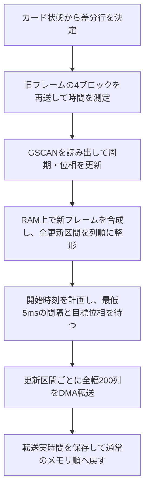

# プレイヤーノードの実装詳細

## タスク構成

ESP32-S3のデュアルコアとArduino環境のFreeRTOSを利用し、[game.hpp](../../src/player/game.hpp)と[drawing.hpp](../../src/player/drawing.hpp)で更新と描画を別コアに分離している。

| 処理 | 担当 | 所有する状態 |
| --- | --- | --- |
| ゲーム更新 | Arduinoの`setup()` / `loop()` | `PacketQueue`、`PacketAnimation`、デモ、スコア、残り時間、自ノードID |
| LCD描画 | `display_task` | LCD、合成スプライト、`PacketRenderer`、ソフトウェアTEの状態 |

描画タスクは優先度1、スタック4096Bで作成し、`DISPLAY_CORE = 1 - ARDUINO_RUNNING_CORE`でArduinoタスクと反対側のコアへ配置する。通常の設定ではゲーム更新がコア1、LCD描画がコア0となる。描画側がDMA完了や走査位相を待っている間も、別コアのゲーム更新は進められる。

ゲーム側は16ms以上経過するとアニメーションを更新し、`DisplaySnapshot`を発行する。スナップショットにはカード4件、表示用のPlayerStatus（スコア・残り時間・準備完了状態・取得済みかどうか）、自ノードID、4ボタン分の押下ビットマスク、フェーズ、操作モード、FIFO同期済みかどうか、および表示情報取得待ちかどうかを格納する。FreeRTOSがバイトコピーできる型であることを`static_assert`で確認している。

受け渡し用のFreeRTOSキューは長さ1で、`xQueueOverwrite()`により未処理の古いスナップショットを最新値で置き換える。描画が追いつかない場合に中間フレームを省略し、古い表示要求を蓄積しない。ゲーム側は描画完了を待たず、描画側はキューが空なら`xQueueReceive(..., portMAX_DELAY)`で待つ。

したがって、更新側は描画処理に対して待ち合わせをしないが、LCD側の処理にはDMA完了待ちと位相待ちがある。16msは更新の目標間隔であって、実表示の62.5FPSを保証する値ではない。アニメーションは実経過時間で進めるので、表示フレームが省略されても時間軸は維持する。

描画タスクは起動表示、固定レイアウト、GSCANの初期推定、最初のスナップショットの描画を済ませてから、ゲーム側へタスク通知を送る。パケットデモの補充タイマー、USBの`hello`送信、押下によるパケット操作はこの通知を受けて開始する。スプライト確保に失敗した場合は通知せず、通信の疎通テストも失敗する。

## プッシュスイッチ

[psw.hpp](../../src/player/psw.hpp)の`PSW_PINS`は画面左からGPIO 4、3、2、1。各スイッチをGPIOとGNDの間に接続し、`INPUT_PULLUP`で押下時LOWとして読む。

押下・解放の両方を`CHANGE`割り込みで検出する。ISRは4個の入力状態と各入力の最終変化時刻を、専用の長さ1のFreeRTOSキューへ`xQueueOverwriteFromISR()`でコピーする。複数回の割り込みは最新状態へまとめるので、ゲーム側は20msの安定判定間隔より短い周期で入力を処理する前提とする。描画の起動完了通知とは別経路で、ISRからLCDやパケットキューを操作しない。

ゲーム側の`psw_update()`は、最後の入力変化から`PSW_DEBOUNCE_MS`（初期値20ms）が経過したビットだけを押下状態へ反映し、新規押下を返す。解放も同じ方法で確定するので、長押しでは再送しない。押下状態は既存の描画スナップショットで渡し、描画側は前回と変わったボタンだけを再描画する。自ノードIDが変わった場合は4個とも描き直す。

オフライン用の`PLAYER_PACKET_DEMO`では、起動時に5件を用意し、以後1秒ごとに1件補充する。押した位置を`nodeLayouts`の送信先へ対応させ、先頭を1件削除する。通常ビルドでは同じ送信先で`send`を送り、成功応答後に削除する。同時押しは左側を優先して1件だけ扱い、空キューでは何もしない。

通信処理とキュー操作のホスト検証手順は、後述の「サーバーとの通信」を参照。

## MCUでの描画用パケット管理

[packet.hpp](../../src/player/packet.hpp)の`Packet`は、`uint16_t id`と`NodeId destination`のみを持つ

`PacketQueue`は容量1024件固定のFIFOリングバッファとして扱う。

キューを変更するのはゲーム側のタスクだけとし、通信受信も同じ`loop()`で処理する。描画側にはコピーしたスナップショットを渡すため、`PacketQueue`に複数タスク向けのロックは不要。

## LCD

### 構成と配線

- MCU: ESP32-S3
- LCD: ST7796S SPI接続 4.0" IPS 回転前解像度320×480 (横向き480×320で使用した)
- 描画ライブラリ: LovyanGFX (RGB565・16bit/pixel)
- 書き込みは SPI 80MHz で行っていて、ユニバーサル基板、線長約10cmの配線での動作を確認できている(動作を保証する文言ではない)。
- 当該ディスプレイアセンブリにはTE信号線が出ていなかったため、GSCAN命令(0x45)によるソフトウェアTEを実装しティアリングの軽減を行っている。ただしあらゆる条件下で完全にティアリングを消すということはできなかった。

[display.hpp](../../src/player/display.hpp)ではディスプレイの設定・DMA等に関する記述を行っている。

### 画面配置

座標は横向き480×320の画面左上が原点、LovyanGFXのSpriteをアニメーション用に200×240で確保している。描画はSprite上で行い、差分を列方向DMA転送する構成である。

なお、わざわざデフォルトの行方向DMAから列方向としているのはディスプレイドライバの液晶走査方向が列方向だからである。行方向DMAのままでは、走査方向と転送方向が90°ずれてしまい、ティアリングが発生しやすくなる。

### アニメーション

[packet_animation.hpp](../../src/player/packet_animation.hpp)の`PacketAnimation`は、キューの状態からカード位置・透明度を更新する。LCDやFreeRTOSには依存しない。

描画側へ渡す`Snapshot`は、同じ`PacketCard`型の4件固定配列。各カードはパケット、現在Y座標、目標Y座標、有効フラグ、フェード経過時間を持ち、4件とも共通の移動・フェード処理で更新し、同じ描画処理で表示する。

先頭3件にはキューの先頭3件を割り当て、最後の1件にはキューから取り除いたカードを画面外へ移動し終えるまで保持する。

カードの初期状態と目標位置は、キューの変化に応じて次のように決める。

1. 新規pushが表示枠に入る場合: 目標位置に置き、透明度0から255へフェードインする。
2. 4件目以降で待っていたカードが3件目の表示枠へ入る場合: 完全不透明のまま上から落下させる。新規pushとして扱わない。
3. 既存カードの繰り上がり: 現在位置から新しい目標位置へ移動する。
4. popされた表示中カード: 退出枠へ移し、下へ移動させる。Y=240に到達すると無効にする。

新規pushの判定には、パケットIDの大小ではなくpush累計とFIFO上の論理位置を使う。既存カードとの対応付けにはパケットIDを使う。

移動とフェードの両方に、正規化した経過時間`t`（0〜1）に対して次のイージングを使う。

```text
ease(t) = 1 - (1 - t)^3
移動位置 = 開始位置 + (目標位置 - 開始位置) × ease(t)
透明度 = 255 × ease(t)
```

### 差分描画と列方向DMA転送

[packet_renderer.hpp](../../src/player/packet_renderer.hpp)の`PacketRenderer`が、前回スナップショットと作業バッファを保持する。

差分は画素ごとの比較ではなく、カードの描画状態から更新が必要なY行を求める。有効フラグ、整数化したY座標、ID、宛先、描画時の透明度が同じなら、そのカードによる更新は不要とする。目標位置やY座標の小数部分だけが変わった場合には転送しない。

変更したカードの旧位置と新位置の行をまとめ、0〜239行にクリップする。初回は240行すべてを対象にする。新しいフレームはスプライト全体を黒で消去して4枚を順番に合成するが、LCDには必要な行だけを送る。

転送は1つの連続したY区間につき全幅200列をまとめて行う。差分が複数のY区間に分かれた場合は、区間ごとに送るか、間の未変更行も含めてまとめて送るかを実測時間で選ぶ。

- 転送開始時刻を待つ前に、全更新区間のRGB565データを列順へ並べ替える。行順の中間バッファは1行分だけ持つ。
- 転送中だけMADCTLの`MV`を解除する。`MY`、`MX`、`ML`、`MH`などの設定は保持する。
- `rotation = 1`に合わせ、LCDのウィンドウ指定では論理Yをcolumn、論理Xをrowへ対応させる。
- 更新区間ごとに200列分のDMA転送を要求し、完了を待つ。新フレームの送信途中に画素の取り出しや並べ替えを挟まない。
- 全ブロックのDMA完了後に、通常のMADCTL設定へ戻す。ウィンドウのキャッシュも無効化する。

パネル固有の操作は[display.hpp](../../src/player/display.hpp)の`ColumnPanel`へまとめている。

全幅の転送要求でも、LovyanGFX内部では32KiB以下のSPI転送へ分割される。大きな転送の処理には`vTaskDelay()`もあるため、SCLKが完全に連続することまでは保証しない。

詳細はデータシート[^2]を参照のこと。

#### フェード合成とメモリ

フェードするカードを描く前に、RAM上の背景を保存する。カードを不透明で描いた後、保存した背景を`255 - 透明度`のアルファで重ね、帯・文字・輪郭をまとめてフェードさせる。

| バッファ | 用途 | 容量 |
| --- | --- | ---: |
| 200×240のRGB565スプライト（PSRAM） | フレーム合成 | 96,000B |
| 200×60のRGB565背景 | フェード対象の背景保存 | 24,000B |
| 200画素のARGB行 | フェード合成 | 800B |
| 200画素のRGB565行 | 行順の取り出し | 400B |
| 200×240のRGB565バッファ | 列順に整形した転送データ | 96,000B |
| 合計 | 上記の画素バッファのみ | 217,200B（約212KiB） |

合成スプライトの96,000Bは実機の2MB QSPI PSRAMに確保する。それ以外の画素バッファ、とくに列順DMA転送バッファは内部RAMに置く。USB受信キューとJSON行バッファも内部RAMを使うため、スプライトまで内部RAMに置くと連続領域を確保できず、`Sprite allocation failed`となる。

### ソフトウェアTE

TE信号を配線できないため、GSCAN（`0x45`）の読み出し値と時刻から周期・位相を推定し、転送開始時刻を選ぶ。列方向転送と位相調整を組み合わせてティアリングが抑制されることを実機で確認している。

#### GSCAN読み出しで確認した条件

ST7796のGSCAN(45h)命令については、データシートとは異なる手順を要するというTFT_eSPIの著者による実機報告[^1]がある。今回はそれを採用した。

[scanline_reader.hpp](../../src/player/scanline_reader.hpp)の`ScanlineReader`で、読み出し手順と最低待機時間を扱っている。

#### 周期・位相の推定

[scan_timing.hpp](../../src/player/scan_timing.hpp)の`ScanTiming`はArduinoやLCDに依存しない数値処理として分離している。

- GSCAN値を0〜511の512カウントとして扱う。512以上は範囲外として除外する。
- 起動時に64サンプルを取り、読み出し後の待ち時間を5.0 / 6.7 / 9.3msで繰り返す。
- 有効サンプル32件以上、値の広がり256以上を必要とする。
- 周期を6〜24msの範囲で探索する。最初は80µs刻み、その最良値の周辺を2µs刻みで探索する。
- カウント値からの位相と経過時間の一致度が0.65以上なら推定を採用する。
- 以後は更新フレームごとの読み出しで位相・周期を少しずつ補正する。周期補正は1回につき最大±2µsとする。
- 位相誤差が周期の35%を超えるサンプルは追従処理に使わない。

実機では約8.75msの周期が推定された。現行の初期値は8.752ms。ただし、これは512カウントモデルに基づくGSCANの推定周期であり、画面の物理的なリフレッシュ周期を独立に測定して確定した値ではない。GSCANと横向き画面のX方向走査との対応も、現在の同期処理で用いるモデル上の仮定である。

#### 転送開始時刻の計画

[soft_te.hpp](../../src/player/soft_te.hpp)の`PacketTransferTiming`が、読み出し・周期推定・転送時間の実測を組み合わせる。

変更のあるフレームでは、次の順番で処理する。



時間測定用のプローブだけは旧フレームの先頭64列を16列ずつ再送するため、この段階で新しい絵は表示しない。差分を分割した方式と、Y区間の隙間も含めてまとめた方式を比較する。各方式の最初の測定は準備用とし、次の測定値を採用する。1区間の場合はまとめる必要がない。事前整形の時間は転送時間の測定に含めない。

採用した時間を列数で割り、同じ行数・区間数だった前回の転送実時間との大きい方を使う。さらに2µs/列を加算して予測値とする。実時間にはウィンドウ設定・画素送信・DMA完了待ちを含め、事前整形とMADCTLの復元は含めない。

各列について、同じ周期の前回走査が過ぎてから次回走査が来るまでに、全幅200列の転送が収まる開始範囲を求める。転送内部の進行は決め打ちせず、200列全体の開始・完了を期限に使う。全列の共通範囲が成立すれば、その中央を開始時刻に選ぶ。この条件は保守的で、大きな更新ではフォールバックへ移る場合がある。

| 同期パラメーター | 現在値・扱い |
| --- | --- |
| カウントモデル | 512カウント、480有効ライン |
| ブランキングの見込み | 32カウント分を開始側へ見込む |
| 走査とのガード | 300µsと起動時位相誤差の95%点÷4の大きい方 |
| 列あたり転送時間の追加余裕 | 2µs |
| GSCANから走査原点への追加位相補正 | 3.90ms固定 |
| 推定・開始範囲が不成立の場合 | 6.75msの基準オフセットと40カウントの余裕を用いる |
| GSCAN後の最低間隔 | 5ms |

追加位相補正は、現在のソースにある`PACKET_PHASE_CORRECTION_US = 3900`を記載している。基準オフセット6.75msと、この追加位相補正は別の値である。

推定未成立、または共通の開始範囲が成立しない場合は、基準オフセットを使う方式へフォールバックし、追加位相補正も適用する。そのフレームのGSCAN値が範囲外なら位相待ちをせず、最低5msの間隔だけを守る。有効値が得られた場合は、5msの間隔を満たせなければ同じ位相の次周期まで待つ。

新フレームのRAM上での合成は、この5msの間隔中に進める。待機中は残り1ms以上なら`vTaskDelay(1)`で他タスクへ実行を譲り、最後の短い待ちには`delayMicroseconds()`を使う。

#### 実測結果と解釈

2026-10-13の試験版で、1列ごとのDMAを16列ブロックへ変更した際の転送時間は次のとおり。幅200列、RGB565、連続した1区間の比較。

| 更新範囲 | 1列ごとのDMA | 16列ブロックDMA |
| --- | ---: | ---: |
| 200×1行 | 約8.2ms | 約0.64ms（18サンプル、621〜671µs） |
| 200×60行 | 約12.9ms | 3.916ms（1サンプル） |
| 200×61行 | 約13.0ms | 約3.95ms（4サンプル） |

これらは旧フレームのプローブ転送、新フレーム合成、GSCAN後の待機を除いた画素転送部分の値。採取時刻も異なり、同じ画像での厳密な比較ではない。16列ブロック化で、転送ごとの固定費を大きく減らせたことを示す参考記録として扱う。

80MHzでRGB565の200×60画素を送る場合、画素データだけの理論時間は2.4ms（`200 × 60 × 16 / 80,000,000`）。実際はウィンドウ設定、RAMアクセス、並べ替え、DMA設定・完了待ちが加わる。フレーム全体にはさらにプローブと同期待ちがあるので、画素転送時間の逆数はFPSにならない。

更新量が増えると転送時間が伸び、安全に転送できる共通の開始範囲が成立しないこともある。周期推定の成功は、あらゆる更新量でティアリングを防げることを保証しない。ガード時間と物理走査との対応は実機調整に基づくもので、厳密な誤差上限としては扱わない。

## サーバーとの通信

[server_link.hpp](../../src/player/server_link.hpp)でUSB CDC上のJSON Linesを処理する。通常ビルドではデモの自動補充を無効にし、`config`で自ノードIDを設定し、`reset`と`push`で表示キューを更新する。オフラインデモは`player.ino`の`PLAYER_PACKET_DEMO`を定義すると利用できる。

通信処理はゲーム側の`loop()`で1回につき最大4096バイトを読み、改行までバッファへ蓄積する。Hardware CDCの受信キューにも最大1行分を確保し、一括更新中の取りこぼしを防ぐ。JSONの分割受信と複数行の連続受信、32768バイトの行とCRLF終端に対応し、行の途中で1秒間受信が止まると設定を無効化して再識別する。JSONの解析後も行の残りが空白だけか確認し、不正な末尾を受け付けない。起動時は`hello`を送り、設定・FIFO同期・フェーズ取得が完了するまで1秒間隔で`hello`または`resync`を再送する。`identify`、不正な`config`、JSON解析失敗、行上限超過、および行途中の受信タイムアウトでは、autoへ戻して設定・FIFO・同期世代・フェーズ・表示値・応答待ちを無効化し、`hello`から識別し直す。キューとアニメーションも初期化し、旧ノードや確認用ダミーの表示を残さない。`reset`は同期世代と全パケットを検証後、一括で適用し、アニメーションも初期化する。

ボタン押下時は、FIFO同期済みかつ取得済みフェーズが`Playing`で、操作モードがmanualの場合だけ、先頭パケットの`send`要求を送る。要求には適用済みの同期世代`sync`と昇順の要求ID`rid`を付け、応答待ち中は追加押下を無視する。`result`の同期世代・要求IDが現在の応答待ちと一致した場合だけ適用し、`ok`が真の場合だけ先頭を削除する。旧世代・旧要求の正当な応答はキューと応答タイマーを変更せず無視する。3秒のSEND応答タイムアウトや、既知のメッセージのフィールド不正などは、取得済みの表示値とFIFOを保持して再同期へ移行する。要求IDは再識別・再同期・再接続でも巻き戻さず、32bit上限を使い切るとMCU再起動まで送信を停止する。上限値と応答順序の前提は[通信仕様](../spec/player.md)を参照。

フェーズは[game_phase.hpp](../../src/player/game_phase.hpp)の`GamePhase`で保持し、通信の`AwaitConfig`・`AwaitReset`・`Synced`とは独立させる。FIFO同期状態は`fifo_synced()`で取得し、プレイヤーの準備完了状態と区別する。`Unknown`は未取得を表す内部状態で、通信上では使用しない。`config`で未取得へ戻り、FIFOの`reset`では保持する。フェーズ変更だけではFIFO・同期世代・SENDの応答待ちを取り消さず、`Finished`への変更後も照合が成立する応答を適用する。ゲーム時間の判定とフェーズ遷移の決定はサーバーが担当し、MCUは通知を反映する。

画面右側に`PREPARING`・`PLAYING`・`FINISHED`、未取得時は`WAITING`を表示する。未設定・同期待ち・フェーズ未取得・表示情報取得待ちには、それぞれ`CONNECTING`・`SYNCING`・`WAIT PHASE`・`WAIT STATUS`を併記する。通常時は`MANUAL`または`AUTO`を表示する。`status`から受信したスコア・残り時間・準備完了状態を反映し、未取得の数値は`----`、準備完了表示は`READY: --`とする。取得後は`READY`または`NOT READY`を表示する。スコアが4桁を超える場合は文字サイズを下げ、32bit整数の上限まで枠内に表示する。オフラインデモはmanual・Playingとして動作する。

`config.node`と`config.mode`は全フィールドを検証してから一括で反映する。モードの初期値はautoとし、modeの欠落や不正をmanualとして扱わない。`status`もscore・remaining・readyを一括で検証し、有効な場合だけPlayerStatusを更新する。

ArduinoJsonの解析前にUTF-8とトークンの構文を検証し、不正なUTF-8（過長表現、欠けた継続バイト、サロゲート値、U+10FFFF超過など）、シングルクォート、引用符なしのキー、標準JSONで認められない数値・エスケープ・文字列中の生の制御文字を拒否する。Unicodeエスケープも検証し、単独のサロゲートがArduinoJsonの復号時に消えてmodeやtypeが別の文字列になることを防ぐ。オブジェクト・配列の構造検証と値の復号はArduinoJsonが担当し、追加フィールドも含めて`NestingLimit(4)`を適用する。深さの数え方と上限超過時の扱いは通信仕様に従う。行上限超過後は途中で1秒以上受信が止まってもLFまで破棄を継続し、LF受信または切断確定時に破棄状態を解除する。

送信が部分書き込みになった場合は未送信部分を保持し、次の`loop()`で続送する。保持中は別の行を送らず、SENDは応答待ちとして追加押下を止める。送信開始から3秒で応答がなければ再同期へ移行するが、未送信部分は新しい行より先に完送してJSON Linesの境界を保つ。設定変更・再識別でもこの順序を守り、100msの切断確定時に旧セッションの未送信部分を破棄する。

表示値を取得済みかどうかと、今回の同期で新しいSTATUSを取得したかどうかは別に管理する。初期設定・再同期ではRESET後のSTATUSを待ち、FIFOとフェーズの同期完了から3秒で未取得なら再同期する。他の通知や通常のFIFO更新RESETで期限を延ばさず、通常RESETだけでは新しい取得待ちを開始しない。取得済みの正常な無通信状態にはタイムアウトを設けない。STATUSの更新はFIFO・モード・フェーズ・SENDの応答待ちを変更しない。

Hardware CDCの接続判定が短時間だけ偽になる場合があるため、100ms連続で未接続となった場合に設定・同期状態を破棄する。

### ビルド

LovyanGFXに加えてArduinoJson 7を使用する。ESP32-S3のHardware CDC、CDC On Boot、QSPI PSRAM（`PSRAM=enabled`）を有効にし、プロトコルへデバッグログを混ぜないようにする。設定は[EspressifのUSB CDC資料](https://docs.espressif.com/projects/arduino-esp32/en/latest/tutorials/cdc_dfu_flash.html)と[PSRAM設定](https://docs.espressif.com/projects/arduino-esp32/en/latest/guides/tools_menu.html#psram)も参照。

```sh
nix develop -c arduino-cli lib install ArduinoJson@7.4.3
nix develop -c arduino-cli compile \
  --fqbn esp32:esp32:esp32s3:USBMode=hwcdc,CDCOnBoot=cdc,DebugLevel=none,PSRAM=enabled \
  --build-path /tmp/d4-player-cdc-build src/player
```

### テスト

[server_link.cpp](../../tests/server_link.cpp)は実際の通信処理をホスト上で動かす。ArduinoJsonのインストール先が異なる場合はインクルードパスを変更する。

ArduinoJson 7.4.3のインライン展開時にGCCが未初期化警告を出すため、ホストテストでは`-fno-inline`を指定する。`-Werror`とサニタイザーは有効にしたまま検証する。

```sh
nix shell nixpkgs#gcc -c bash -c '
  c++ -std=c++17 -fno-inline -Wall -Wextra -Werror -fsanitize=address,undefined \
    -I "$HOME/Arduino/libraries/ArduinoJson/src" \
    tests/server_link.cpp -o /tmp/d4-server-link-test &&
  /tmp/d4-server-link-test
'
```

[player_cdc.py](../../tests/player_cdc.py)はLinuxから実機へJSONを送る、ゲームサーバーの代わりのテストプログラム。Python標準ライブラリだけを使用する。シリアルモニターを閉じ、デバイスへの読み書き権限を持つユーザーで実行する。

```sh
scp tests/player_cdc.py rock3b.home.arpa:/tmp/player_cdc.py
ssh rock3b.home.arpa \
  'nix shell nixpkgs#python3 -c python3 -u /tmp/player_cdc.py --port /dev/ttyACM0 --idle-seconds 30'
```

`--buttons`を追加すると、通常の自動テストの後、各段階でEnterを押してから左端のボタンを操作する。まずautoかつPlayingで10秒間送信しないことを確認し、manualへ再設定する。Preparing・Finishedでも各10秒間ボタンを押しても送信しないことを確認し、その後6回の押下で失敗応答による保持、終了後の成功応答、同世代の旧RID・旧世代の遅延応答の無視、および応答タイムアウトを検証する。自動テストだけの場合は物理スイッチからの`send`を検証しない。ボタンテスト終了時はFinishedとし、ノードAにパケット1002・1003が残る。

2026-10-21、`rock3b.home.arpa`の`/dev/ttyACM0`に接続したESP32-S3で自動テストを実施し、スプライト確保と初回描画の完了後に通信を開始すること、1024件の一括更新、異常入力からの再同期、30秒待機後のキャッシュ保持を確認した。`send`と成功・失敗応答の処理はホストテストで確認済み。物理ボタンを使う実機テストは未実施。

2026-10-25、開発PC（Linux x86_64）の`/dev/ttyACM0`に接続したESP32-S3（UID `D8F184D4DB1C`）へ更新版を書き込み、以下を確認した。

- ホストテストはAddressSanitizer・UndefinedBehaviorSanitizer付きで通過。通常版・`PLAYER_PACKET_DEMO`版のビルドも通過した。
- USB CDCの自動テストは、IDENTIFY、同期世代・要求ID・フェーズの検証、フェーズ未取得時の再試行、再識別、1024件の同期、32768バイトとCRLFの境界、受信タイムアウト、不正入力からの復旧、30秒間の無通信後のFIFO保持を確認した。
- 物理ボタンの操作でPreparing・Finishedの送信停止、失敗応答での保持、Finished通知後の成功応答、同世代の旧RID・旧世代の応答の無視、応答タイムアウト、および再同期後の送信再開を確認した。
- フェーズ表示の文字に重なり・欠けがないことを目視確認した。

ボタンテストの開始待ち中はPreparingとし、Enter後にPlayingへ切り替える。これにより、案内待ち中の先行押下がテスト側の応答遅延でタイムアウトすることを防ぐ。USBケーブルの物理的な抜き差しは、この日の実機確認には含まない。

同日、`config.mode`・`status`・復旧処理の対応版を開発PCの`/dev/ttyACM0`のESP32-S3（UID `3CF684D4DB1C`）へ書き込み、追加検証した。

- AddressSanitizer・UndefinedBehaviorSanitizer付きホストテスト、通常版・デモ版のビルドが通過した。mode・statusの型と範囲、表示値の一括更新、再同期での新しいSTATUS取得、3秒の取得期限、他の通知で期限が延長されないこと、正常な無通信状態、およびタイマーの周回を確認した。
- USB自動テストで、新しいSTATUSの取得期限、不正なCONFIG・JSON・行上限超過・受信停止によるHELLOからの復旧、1024件の同期、および30秒間の無通信後のキャッシュ保持を確認した。
- 物理ボタンでauto・Playingの送信停止、manualのPreparing・Finishedの送信停止、manual・PlayingのSEND、成功・失敗・遅延応答、およびタイムアウトからの復旧を確認した。
- スコア`2147483647`、残り120秒、`READY`・`MANUAL`が見切れずに表示されることを目視確認した。IDENTIFY後は数値が`----`、準備完了表示が`READY: --`、接続表示が`CONNECTING`となり、旧ノードAとダミーパケットが消えることも確認した。

さらに同日、部分書き込みの続送とJSON構文検証を追加した。AddressSanitizer・UndefinedBehaviorSanitizer付きホストテストでSENDの全分割位置、書込停止、再識別・タイムアウト・切断時の行境界、および非標準JSONの拒否を確認し、通常版・デモ版のビルドも通過した。同じUID `3CF684D4DB1C`へ通常版を書き込み、USB自動テストでシングルクォート・引用符なしのキー・先頭に`+`がある数値の拒否と再識別、既存の復旧処理、30秒間の無通信後のキャッシュ保持を確認した。部分書き込みは模擬ポートで検証し、この追加修正では物理ボタンの再検証は行っていない。

行上限超過後の破棄継続とUTF-8検証の修正後も、AddressSanitizer・UndefinedBehaviorSanitizer付きホストテストと通常版のビルドが通過した。同じ実機のUSB自動テストで、不正なUTF-8からの再識別、正しい日本語・絵文字の受理、受信停止をまたいだ超過行の破棄、およびLF後の再設定を確認した。切断確定時の破棄解除とUTF-8の境界値・分割受信はホストテストで確認した。

2026-10-26、Unicodeエスケープのサロゲートペア検証とネスト上限の境界テストを追加した。AddressSanitizer・UndefinedBehaviorSanitizer付きホストテストと通常版のビルドが通過した。単独・逆順・途中に別の文字が入るサロゲートの拒否、正しいペアとリテラルのバックスラッシュの受理、深さ4の受理・5の拒否を確認した。USB自動テストにもケースを追加したが、この時点では開発PCに接続したボードが見つからず、更新版の実機テストは未実施である。

準備完了要求`ready`の送信、両端長押しの判定、および長押し中・通知中の表示は未実装である。

## 参考文献

[^1]: svofski, Bodmer. "Issue #731 - reading GSCAN (45h) of ST7796S". GitHub.  [https://github.com/Bodmer/TFT_eSPI/issues/731](https://github.com/Bodmer/TFT_eSPI/issues/731), (accessed 2026-10-16).

[^2]: Sitronix Technology Corporation. "ST7796S Datasheet". Version V1.0.

