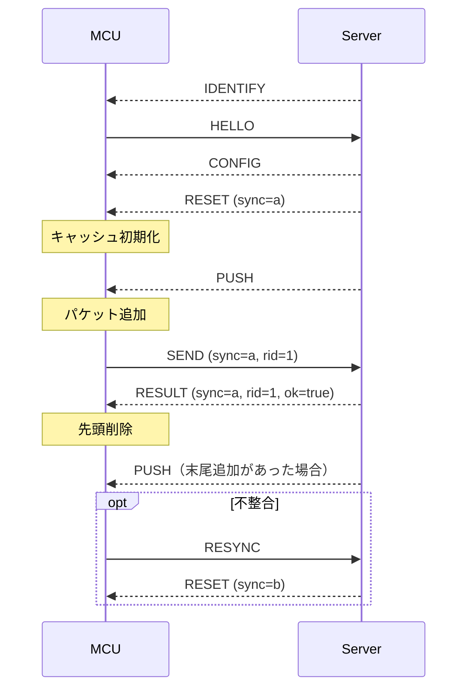

# ノードとパケット

## ノードIDと表示

ノードIDの定義は[node_id.hpp](../../src/player/node_id.hpp)、表示名・色・隣接ノードは[node_config.hpp](../../src/player/node_config.hpp)で管理する。

| 種別 | 内部ID | 表示名 | 表示色 |
| --- | --- | --- | --- |
| 未設定 | `None = 0` | `?` | 黒 |
| プレイヤー | `P1 = 1` | A | 赤 |
| プレイヤー | `P2 = 2` | B | オレンジ |
| プレイヤー | `P3 = 3` | C | 黄 |
| プレイヤー | `P4 = 4` | D | 緑 |
| プレイヤー | `P5 = 5` | E | シアン |
| プレイヤー | `P6 = 6` | F | 青 |
| プレイヤー | `P7 = 7` | G | 紫 |
| プレイヤー | `P8 = 8` | H | ピンク |
| ボット | `B1 = 9` | I | 白 |
| ボット | `B2 = 10` | J | 灰 |
| ボット | `B3 = 11` | K | 茶 |

ボット1〜3は内部IDのB1〜B3、画面の表示名I〜Kに対応する。下部の4ボタンは、次の順番で左から描画する。

| 自ノード | 左端 | 左から2番目 | 左から3番目 | 右端 |
| --- | --- | --- | --- | --- |
| A | B | I | K | H |
| B | C | J | I | A |
| C | D | J | K | B |
| D | E | J | I | C |
| E | F | K | I | D |
| F | G | I | J | E |
| G | H | I | K | F |
| H | A | J | K | G |

# サーバー↔プレイヤーノード間通信インターフェース

## 基本仕様

- 通信経路: USB CDC
- データ形式: JSON Lines (UTF-8, 1行1オブジェクト)
- MCU: ESP32-S3, Arduino(FreeRTOS)
- JSONライブラリ: ArduinoJson 7
- サーバー: Radxa ROCK 3B, 中央集権型で、ゲームロジックを動かしながら全パケットを正本として管理する

本節は初期実装で使用する接続・識別、FIFO同期、および転送要求・応答の通信仕様を定義する。ゲームルールは[ルールの正本](../rules.md)、サーバー側の状態管理は[サーバー仕様](./server.md)に従う。フェーズ・操作状態・スコア・残り時間の表示通知は後日追加する。

## JSON形式

```json
{"type":"resync","data":{}}
```

- メッセージ名は小文字とし、大文字・小文字を区別する。`type`は文字列、`data`はオブジェクトを必須とし、引数のない`identify`・`resync`も`"data":{}`を含める。
- 以下に示す各メッセージの引数はすべて必須とする。整数・真偽値・文字列の型変換は行わない。未定義の追加フィールドは無視する。
- 送信時はLFで終端し、受信時はLF・CRLFを受け付ける。空行は無視する。途中で分割された行は終端まで蓄積し、連続する複数行は受信順に処理する。
- 1行の上限は終端のLF・CRLFを除く32768バイトとする。通信路にデバッグログを混在させない。

### メッセージ一覧

#### MCU → Server

- hello: 接続・識別
  - uid: `ESP.getEfuseMac()`を大文字・ゼロ埋め12桁の16進文字列にした端末識別子

- send: パケットの転送を要求
  - sync: 最後に適用した`reset`の同期世代
  - rid: 要求ID
  - pid: パケットID
  - to: 送信先ノード

- resync: キャッシュ再同期をサーバーに要求

#### Server → MCU

- identify: MCUに操作を停止して`hello`から識別をやり直すよう要求

- config: ノードの設定
  - node: ノード

- reset: MCU側キャッシュ全更新
  - sync: この`reset`から有効になる同期世代
  - packets: 更新後のパケット配列。各要素は`{"pid": 1, "dst": 2}`

- push: MCU側キャッシュ末尾へのパケット追加
  - pid: パケットID
  - dst: 宛先ノード

- result: `send`の処理結果
  - sync: 対応する`send`の同期世代をそのまま返す
  - rid: 対応する`send`の要求IDをそのまま返す
  - ok: 転送要求の受理判定(boolean)。真の場合は送信元FIFOから先頭を取り除く。最終目的地への配送成功を表す値ではない。

サーバーからの識別要求・同期、MCUからの転送要求、およびサーバーの応答例を以下に示す。各行が独立したメッセージである。

```json
{"type":"identify","data":{}}
{"type":"reset","data":{"sync":"00000000000000000000000000000002","packets":[{"pid":10,"dst":3}]}}
{"type":"send","data":{"sync":"00000000000000000000000000000002","rid":1,"pid":10,"to":2}}
{"type":"result","data":{"sync":"00000000000000000000000000000002","rid":1,"ok":true}}
```

### 制約

- `hello.uid`は大文字の16進文字12桁とする。`config.node`は1〜8、`pid`は0〜65535、`dst`および`send.to`は1〜11の整数とする。同じキュー内で`pid`を重複させない。隣接関係などの転送先の妥当性は、通信形式の検証後にサーバーのゲームロジックが判定する。
- `sync`は大文字の16進文字32桁とする。サーバーが各`reset`に新しい一意の識別子を発行し、同じFIFO内容でも再利用しない。ゲームのReset、セッションの再接続、サーバー再起動をまたいでも再利用しない。値の大小には意味を持たせず、一致だけを判定する。
- `rid`は0〜4294967295の整数とし、MCUが新しい`send`ごとに昇順で発行する。採番カウンタはMCU起動時に初期化し、`identify`・`config`・`reset`の受信、`resync`の要求、ゲームのReset、および接続の再確立では巻き戻さない。上限に達した場合は追加の`send`を停止し、MCUを再起動して新しいシリアルセッションを確立する。
- キャッシュは最大1024件。JSONは改行を除いて1行32768バイトまでとし、CRLFも受け付ける。
- `send`は同時に1件だけ処理する。MCUは同期世代・要求ID・送信対象のPIDを応答待ち情報として保持する。`result`の`sync`と`rid`が現在の同期世代および応答待ち情報と一致した場合にのみ適用し、成功時のみ先頭を削除し、失敗時は残す。先頭のPIDが送信対象と一致しない場合は再同期する。
- MCUは`result`の`sync`・`rid`・`ok`を検証する。形式が正しい応答でも、同期世代または要求IDが一致しない場合、応答待ちでない場合、または未設定・同期待ちの場合は無視し、現在のキュー・応答待ち情報・応答タイマーを変更しない。必須フィールドの欠落など、不正な形式は再同期の対象とする。
- 応答が3秒以内に来ない場合は追加送信を止めて`resync`を要求する。`reset`が来るまではキャッシュを変更しない。
- サーバーは形式が正しい新規`send`を受信した時点で、そのセッションの最大要求IDを更新する。ゲーム操作が拒否された場合も要求IDを使用済みとし、`config`・`reset`・`resync`およびゲームのResetでは履歴を消去しない。最初の要求IDは0以上であればよく、番号の欠番を許可する。以降、最大要求ID以下の`send`は無視し、ゲーム操作を再適用せず、応答も重複送信しない。
- サーバーは新規`send`の同期世代と要求IDを付けて`result`を1回返し、接続ごとの送信順序を維持する。MCUは同じ要求IDで再送せず、必要な場合は再同期後に新しい要求IDで操作する。
- サーバーは`reset`の送信キュー登録時に、そのセッションの現在の同期世代を新しい`sync`へ切り替える。正本のFIFOコピーの確定・世代の切替・送信キュー登録は、他の入力イベントを挟まずに行う。登録失敗時はセッションを終了する。MCUへの到着や適用を待ってから切り替えない。
- 現在の同期世代と一致しない新規`send`は、FIFOのPIDが一致しても実行せず、要求に含まれる`sync`・`rid`で`result(ok=false)`だけを返す。既に新しい世代の`reset`が送信順序上で先行しているため、追加の`reset`を送らない。まだ`reset`を発行していないセッションでもゲーム操作を実行しない。
- 正当な`reset`の適用時には応答待ちを取り消し、同期世代とキューを一括で置き換える。以降の`send`には新しい同期世代と新しい要求IDを用いる。旧世代の`send`はサーバーで拒否し、その遅延応答もMCUで無視する。不正な`reset`では既存の同期世代とキャッシュを保持する。
- 不正な入力、キューあふれ、キャッシュ内パケットのPID重複は`resync`の対象とする。不正な`reset`では既存キャッシュを保持する。
- 改行前の受信が1秒間途絶えた場合も`resync`を要求する。大きな行を分割して送る場合は、途中で1秒以上停止しないこと。

### 接続・識別と再試行

| MCUの状態 | MCUの動作 | サーバーの動作 |
|---|---|---|
| identify受信（全状態） | 設定・同期世代・応答待ちを無効化して操作を停止し、直ちに`hello`を送信 | 新しいセッションで直ちに`identify`を送信し、有効な`hello`を受信するまで1秒間隔で再送 |
| 未設定 | 通信開始時に`hello`を送信し、有効な`config`を受け取るまで1秒間隔で再送 | UIDを識別する。割当済みの場合は`config`、現在のFIFOの`reset`の順に送信 |
| 設定済み・同期待ち | `resync`を要求し、有効な`reset`を受け取るまで1秒間隔で再送 | 割当済みの場合は現在のFIFOの`reset`を送信 |
| 同期済み | `push`・`result`を適用し、ボタン操作で`send`を送信 | ゲーム状態の変更と転送要求に応じて通知・応答を送信 |

UIDが未割当の場合、サーバーは識別情報と接続状態をWeb管理画面に公開し、対応付けを待つ。ノードを推測して`config`を送らない。管理者が対応付けた時点で`config`、`reset`の順に初期同期する。

`identify`を繰り返し受信した場合も`hello`を返すが、MCUの要求IDカウンタは維持する。サーバーは有効な`hello`を受信した時点で`identify`の再送を停止する。HELLO待ちに届いた旧`send`・`resync`は無視し、ゲーム操作・要求IDの履歴に反映せず、セッションを切断しない。

同じセッションから同じUIDの`hello`を繰り返し受信しても、新しいセッションを作らず、要求IDの履歴を維持して設定・同期を再実行する。同じセッションで異なるUIDを名乗った場合はセッションを終了する。異なるセッション間のUID重複はサーバー仕様の規則に従う。

有効な`config`を受け取ったMCUは応答待ちを取り消して同期待ちに入り、有効な`reset`を受け取ってから操作を再開する。未設定・同期待ちでは`send`を送らず、`push`は適用しない。未設定で受け取った`reset`も適用せず、`hello`を継続する。`config`・`reset`・`push`への受信確認メッセージは設けない。

MCUがUSB CDCの未接続を100ms連続して検出した場合は、設定・同期世代・応答待ち・受信中の行を破棄し、再接続後は`hello`から開始する。短時間の切断をMCUが検出できなくても、サーバーの新しいセッションからの`identify`によって識別を再開する。サーバーは旧セッションの受信途中のデータと未送信メッセージを破棄し、旧Session IDからのイベントを新しいセッションへ引き継がない。同期済みの無通信状態にはタイムアウトを設けない。

### FIFO同期と送信順序

`reset.packets`は送信元となるサーバーFIFO全体を、先頭から末尾の順で表す。空のFIFOには空配列`[]`を使用する。MCUは容量・全要素の形式・PIDの一意性を検証してから、一括でキューを置き換える。

| 契機 | サーバーからの送信 |
|---|---|
| 新しいセッションの開始 | `identify`。有効な`hello`を受信するまで再送 |
| 初期設定・対応付け変更 | `config` → 現在のFIFOの`reset` |
| 割当済みMCUからの`resync` | 現在のFIFOの`reset` |
| パケット生成・他ノードからの受信による末尾追加 | 対象MCUへFIFO順に`push` |
| 正当な`send`の受理 | 送信元へ`result(ok=true)`。送信元の先頭削除を追加の`reset`で重複通知しない |
| 同期世代不一致による新規`send`の拒否 | 要求の`sync`・`rid`で`result(ok=false)`のみ。追加の`reset`は不要 |
| 同期世代が一致した新規`send`のFIFO・ゲーム状態による拒否 | `result(ok=false)` → 新しい同期世代と現在のFIFOの`reset` |
| 自動転送など、MCUの`send`以外によるキューの削除 | 変更後のFIFOの`reset` |
| ゲームのReset | 空配列の`reset`。`config`の再送は不要 |
| 対応付け解除 | 対象MCUへ空配列の`reset`。以後、対応付けまでゲーム情報を追加しない |

新規`send`を拒否した場合はゲーム上のFIFOを変更しない。同期世代が一致しており、割当済みであれば応答後に新しい世代の正本のFIFOで再同期する。未割当の識別済みMCUからの新規`send`には、要求の`sync`・`rid`で`result(ok=false)`だけを返す。未割当のMCUからの`resync`は状態を変更せず、対応付けを待つ。

同じ`send`処理で送信元へ`push`などの追加通知が必要な場合は、`result`を先に送信キューへ登録する。転送先がプレイヤーFIFOへ追加される場合は、そのMCUへ`push`を送る。配送完了または破棄によりパケットが消滅する場合は、転送先へ`push`を送らない。

`reset`には送信順序上のその時点までの状態変更を含め、それより後の状態変更を後続の`push`または`reset`で通知する。`reset`に含めた末尾追加を、後続の`push`で重複通知しない。状態通知の復旧には新しい正本の`reset`を用い、`push`や成功した`result`を再送しない。

RESETと転送要求が行き違う場合の処理例を以下に示す。`a`・`b`は異なる同期世代とする。

| 順序 | 処理と状態 |
|---|---|
| 1 | MCUが`send(sync=a, rid=1, pid=10)`を送信。サーバーには未到着 |
| 2 | サーバーがFIFO`[10]`の`reset(sync=b)`を送信キューへ登録し、現在世代をbへ切り替える |
| 3 | MCUがRESETを適用して旧要求の応答待ちを取り消し、FIFO`[10]`を保持 |
| 4 | サーバーが旧SENDを受信。世代不一致として実行せず、`result(sync=a, rid=1, ok=false)`のみ送信。FIFO`[10]`を維持 |
| 5 | MCUが旧RESULTを無視。新しい`send(sync=b, rid=2, pid=10)`を送信できる |

### 不正データと通信失敗

| 事象 | 受信側の動作 |
|---|---|
| MCUが不正なJSON・必須フィールドの欠落・型や範囲の不正・未知のメッセージ・方向が逆のメッセージを受信 | 既存キャッシュを保持して同期待ちに移る。設定済みなら`resync`、未設定なら`hello`で復旧 |
| MCUが行上限超過を検出 | 当該行をLFまで破棄して再同期を要求 |
| MCUが行途中の1秒間の受信停止を検出 | 部分行を破棄して再同期を要求 |
| サーバーがHELLO待ちに`send`・`resync`など有効な`hello`以外の入力を受信 | 入力を破棄して`identify`の再送を継続。ゲーム操作を実行せず、受信を理由にセッションを終了しない |
| サーバーがHELLO待ちに不正なJSON・行上限超過・行途中の1秒間の受信停止を検出 | 当該行をLFまで破棄し、`identify`の再送を継続 |
| サーバーが識別後に不正なJSON・必須フィールドの欠落・型や範囲の不正・未知のメッセージ・方向が逆のメッセージを受信 | ゲーム操作を実行せず、当該セッションを終了して`Disconnected`を通知 |
| サーバーが識別後に行上限超過・行途中の1秒間の受信停止を検出 | 当該セッションを終了して`Disconnected`を通知 |
| 形式は正しいが同期世代・ゲーム状態・FIFO・隣接関係に適合しない新規`send` | 上記の拒否応答を実行。同期世代不一致では追加の`reset`を送らず、世代が一致する場合は再同期。通信形式の不正とは区別 |
| サーバーの送信キュー溢れ・書込失敗 | サーバー仕様に従って当該セッションを終了。確定済みのゲーム状態は維持 |

同期世代や要求IDを読み取れない不正な`send`に対して、推測した値や必須フィールドを欠く`result`を返さない。不正なデータをそのまま相手へ送り返さず、検出内容は通信路とは別のログに記録する。

### 通信シーケンス



図中の`a`・`b`は異なる32桁の同期世代を表す。要求ID・同期世代付きのメッセージと`identify`は、現行の[MCU通信実装](../../src/player/server_link.hpp)および通信テストへの追加対応が必要である。
