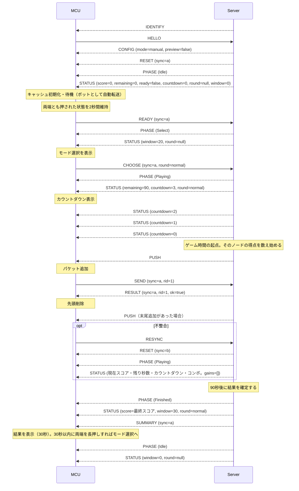

# ノードとパケット

## ノードIDと表示

ノードIDの定義は[node_id.hpp](../../src/player/node_id.hpp)、表示名・色・隣接ノードは[node_config.hpp](../../src/player/node_config.hpp)で管理する。

| 種別 | 内部ID | 表示名 | 表示色 |
| --- | --- | --- | --- |
| 未設定 | `None = 0` | `?` | 黒 |
| プレイヤー | `P1 = 1` | A | 赤 |
| プレイヤー | `P2 = 2` | B | オレンジ |
| プレイヤー | `P3 = 3` | C | 黄 |
| プレイヤー | `P4 = 4` | D | 緑 |
| プレイヤー | `P5 = 5` | E | シアン |
| プレイヤー | `P6 = 6` | F | 青 |
| プレイヤー | `P7 = 7` | G | 紫 |
| プレイヤー | `P8 = 8` | H | ピンク |
| ボット | `B1 = 9` | I | 白 |
| ボット | `B2 = 10` | J | 灰 |
| ボット | `B3 = 11` | K | 茶 |

ボット1〜3は内部IDのB1〜B3、画面の表示名I〜Kに対応する。下部の4ボタンは、次の順番で左から描画する。

| 自ノード | 左端 | 左から2番目 | 左から3番目 | 右端 |
| --- | --- | --- | --- | --- |
| A | B | I | K | H |
| B | C | J | I | A |
| C | D | J | K | B |
| D | E | J | I | C |
| E | F | K | I | D |
| F | G | I | J | E |
| G | H | I | K | F |
| H | A | J | K | G |

# サーバー↔プレイヤーノード間通信インターフェース

## 基本仕様

- 通信経路: USB CDC
- データ形式: JSON Lines (UTF-8, 1行1オブジェクト)
- MCU: ESP32-S3, Arduino(FreeRTOS)
- JSONライブラリ: ArduinoJson 7
- サーバー: Radxa ROCK 3B, 中央集権型で、ゲームロジックを動かしながら全パケットを正本として管理する

本節は接続・識別、操作モードと確認表示の設定、長押しとモード選択の要求、FIFO同期、筐体の段階・スコア・残り時間・最終結果の通知、練習ラウンドの練習用キュー、および転送要求・応答の通信仕様を定義する。ゲームルールは[ルールの正本](../rules.md)、サーバー側の状態管理は[サーバー仕様](./server.md)に従う。

## 通信の互換性

この通信仕様は、一斉ゲーム向けの旧来の仕様と互換性を持たない。`phase`の値に`Idle`・`Select`を足し、`status`に`round`・`window`（と練習中の`bots`）を足し、MCUからの`choose`を足した。旧来のファームウェアは、未知のフェーズを受け取ると再同期を繰り返すため、どのみちサーバーと全プレイヤー基板を同時に更新する必要がある。そのため、旧来のファームウェアでも動く拡張にはしない。LEDノードの通信は変えない。

## JSON形式

```json
{"type":"resync","data":{}}
```

- メッセージ名は小文字とし、大文字・小文字を区別する。`type`は文字列、`data`はオブジェクトを必須とし、引数のない`identify`・`resync`も`"data":{}`を含める。
- 以下に示す各メッセージの引数はすべて必須とする。整数・真偽値・文字列の型変換は行わない。未定義の追加フィールドは無視する。
- 送信時はLFで終端し、受信時はLF・CRLFを受け付ける。空行は無視する。途中で分割された行は終端まで蓄積し、連続する複数行は受信順に処理する。
- 1行の上限は終端のLF・CRLFを除く32768バイトとする。通信路にデバッグログを混在させない。

### メッセージ一覧

#### MCU → Server

- hello: 接続・識別
  - uid: `ESP.getEfuseMac()`を大文字・ゼロ埋め12桁の16進文字列にした端末識別子

- send: パケットの転送を要求
  - sync: 最後に適用した`reset`の同期世代
  - rid: 要求ID
  - pid: パケットID
  - to: 送信先ノード

- resync: キャッシュ再同期をサーバーに要求

- ready: 両端のボタンの2秒長押しを通知。モード選択へ進む合図であり、操作モードの変更やラウンドの開始は要求しない
  - sync: 最後に適用した`reset`の同期世代

- choose: モード選択の結果を通知
  - sync: 最後に適用した`reset`の同期世代
  - round: `normal`（通常）または`tutorial`（練習）の文字列

#### Server → MCU

- identify: MCUに操作を停止して`hello`から識別をやり直すよう要求。LEDノードと共通の識別要求

- config: ノードの設定
  - node: ノード
  - mode: サーバー上の現在の操作モード。`manual`（人の参加を受け付ける）または`auto`（ボットに固定）の文字列
  - preview: 実機の確認表示中か（boolean）。通常はfalse。trueはmodeがautoの場合だけ有効

- phase: その筐体の段階の通知。全体のフェーズではない
  - phase: `Preparing`（停止中）・`Idle`（待機）・`Select`（モード選択）・`Playing`（ラウンド）・`Finished`（結果）のいずれかの文字列

- status: 対応付けられたプレイヤーのスコア・獲得点・コンボと、その筐体の段階に応じた残り時間・カウントダウン・段階の残り時間の通知
  - score: 現在のラウンドの得点の絶対値。0〜2147483647の整数。通常ラウンドとその結果以外は0
  - remaining: 通常ラウンドの残り秒数。0〜ゲーム時間の整数（現行ルールでは0〜90）。カウントダウン中は90。通常ラウンドの段階以外は0
  - ready: 常にfalse（boolean）。かつての準備完了を表す項目で、形式を保つために残す
  - countdown: ラウンドが始まるまでの秒数。0〜3の整数。カウントダウン中は3・2・1、それ以外は0
  - round: 行っているラウンドの種別。`"normal"`・`"tutorial"`・null。通常ラウンドとその結果の段階は`normal`、練習ラウンドは`tutorial`、それ以外はnull
  - window: その段階が時間切れで待機へ戻るまでの秒数。モード選択は20〜0、結果は30〜0、練習ラウンドは操作がない状態での残り60〜0、それ以外は0。0〜60の整数
  - rank: 常にnull。ラウンドは1人で行うため順位を付けない
  - gains: この筐体へ前回送った`status`より後に入った点を、入った順に並べた配列。0〜16個の1〜15の整数。点が入っていなければ空配列`[]`
  - combo: 送信成功コンボの数。0〜999の整数。得点には影響しない表示専用の値
  - bots: 練習ラウンドの間だけ付ける任意の項目。B1・B2・B3の実際のFIFO使用量を、この順に並べた3要素の配列。各要素は0〜4の整数で、LED制御の`BUFFER`と同じ値

- reset: MCU側キャッシュ全更新。練習ラウンドの間は、練習用キューの内容を送る
  - sync: この`reset`から有効になる同期世代
  - packets: 更新後のパケット配列。各要素は`{"pid": 1, "dst": 2}`

- push: MCU側キャッシュ末尾へのパケット追加
  - pid: パケットID
  - dst: 宛先ノード

- result: `send`の処理結果
  - sync: 対応する`send`の同期世代をそのまま返す
  - rid: 対応する`send`の要求IDをそのまま返す
  - ok: 転送要求の受理判定(boolean)。真の場合は送信元FIFOから先頭を取り除く。最終目的地への配送成功を表す値ではない。

- summary: 対応付けられたプレイヤーの確定済みのラウンド結果。結果の段階の通常表示に使用
  - sync: 結果を適用する`reset`の同期世代
  - score: そのラウンドの最終スコア。0〜2147483647の整数
  - rank: 常にnull。ラウンドは1人で行うため順位を付けない
  - eligible: 常にtrue（boolean）。通常ラウンドを最後まで行った結果だけを通知する
  - topPercent: 過去の通常ラウンドを含めた上位何%か。上位50%以内なら1〜50の整数、それ以外はnull。[上位%の規則](../rules.md#上位)に従い、サーバーが決める
  - bottomHalf: 上位%が51%以上で、下位50%であることだけを知らせる場合にtrue（boolean）。値そのものは送らない。それ以外はfalse
  - gameBest: そのラウンドの自分の得点。0〜2147483647の整数。ラウンドは1人で行うため、常に整数
  - gameBestNodes: 自ノードの番号（1〜8の整数）だけを含む1要素の配列
  - hourBest: このラウンドが終わった時間帯（日本時間の正時で区切る）のベストスコア。0〜2147483647の整数またはnull
  - hourBestStart: hourBestの時間帯の開始の時。日本時間の0〜23の整数。hourBestがnullならnull
  - hourBestMine: hourBestがこのラウンドの、この筐体のプレイヤーの結果ならtrue（boolean）
  - allTimeBest: 通算のベストスコア。0〜2147483647の整数またはnull
  - allTimeBestMine: allTimeBestがこのラウンドの、この筐体のプレイヤーの結果ならtrue（boolean）

サーバーからの識別要求・同期、MCUからの転送要求・モード選択、およびサーバーの応答例を以下に示す。各行が独立したメッセージである。

```json
{"type":"identify","data":{}}
{"type":"config","data":{"node":1,"mode":"manual","preview":false}}
{"type":"reset","data":{"sync":"00000000000000000000000000000002","packets":[{"pid":10,"dst":3}]}}
{"type":"phase","data":{"phase":"Playing"}}
{"type":"status","data":{"score":23,"remaining":87,"ready":false,"countdown":0,"round":"normal","window":0,"rank":null,"gains":[15,8],"combo":4}}
{"type":"status","data":{"score":0,"remaining":0,"ready":false,"countdown":0,"round":"tutorial","window":48,"rank":null,"gains":[],"combo":0,"bots":[1,4,0]}}
{"type":"choose","data":{"sync":"00000000000000000000000000000002","round":"normal"}}
{"type":"send","data":{"sync":"00000000000000000000000000000002","rid":1,"pid":10,"to":2}}
{"type":"result","data":{"sync":"00000000000000000000000000000002","rid":1,"ok":true}}
```

### 制約

- `hello.uid`は大文字の16進文字12桁とする。`config.node`は1〜8、`pid`は0〜65535、`dst`および`send.to`は1〜11の整数とする。同じキュー内で`pid`を重複させない。隣接関係などの転送先の妥当性は、通信形式の検証後にサーバーのゲームロジックが判定する。
- `config.mode`は`manual`・`auto`、`phase.phase`は上記5種類の文字列だけを受け付け、大文字・小文字を区別する。`config.preview`は必須のbooleanとし、trueとmanualの組合せは不正とする。MCUはFIFO同期済みかつ取得済みのフェーズが`Playing`で、`status.countdown`が0で、有効な`config`の操作モードが`manual`かつpreviewがfalseの場合だけ、新規`send`を送信する。
- `choose.round`は`normal`・`tutorial`の文字列だけを受け付ける。`status.round`は`normal`・`tutorial`・nullのいずれか、`status.window`は0〜60の整数とする。`status.bots`は練習ラウンドの間だけ付く任意の項目で、付いている場合は0〜4の整数が3つの配列とする。
- `sync`は大文字の16進文字32桁とする。サーバーが各`reset`に新しい一意の識別子を発行し、同じFIFO内容でも再利用しない。運転の開始・停止、セッションの再接続、サーバー再起動をまたいでも再利用しない。値の大小には意味を持たせず、一致だけを判定する。
- `rid`は0〜4294967295の整数とし、MCUが新しい`send`ごとに昇順で発行する。採番カウンタはMCU起動時に初期化し、`identify`・`config`・`reset`の受信、`resync`の要求、運転の開始・停止、および接続の再確立では巻き戻さない。上限に達した場合は追加の`send`を停止し、MCUを再起動して新しいシリアルセッションを確立する。
- キャッシュは最大1024件。JSONは改行を除いて1行32768バイトまでとし、CRLFも受け付ける。
- `send`は同時に1件だけ処理する。MCUは同期世代・要求ID・送信対象のPIDを応答待ち情報として保持する。`result`の`sync`と`rid`が現在の同期世代および応答待ち情報と一致した場合にのみ適用し、成功時のみ先頭を削除し、失敗時は残す。先頭のPIDが送信対象と一致しない場合は再同期する。
- MCUは`result`の`sync`・`rid`・`ok`を検証する。形式が正しい応答でも、同期世代または要求IDが一致しない場合、応答待ちでない場合、または未設定・同期待ちの場合は無視し、現在のキュー・応答待ち情報・応答タイマーを変更しない。必須フィールドの欠落など、不正な形式は再同期の対象とする。
- 応答が3秒以内に来ない場合は追加送信を止めて`resync`を要求する。`reset`が来るまではキャッシュを変更しない。
- サーバーは形式が正しい新規`send`を受信した時点で、そのセッションの最大要求IDを更新する。ゲーム操作が拒否された場合も要求IDを使用済みとし、`config`・`reset`・`resync`および運転の開始・停止では履歴を消去しない。最初の要求IDは0以上であればよく、番号の欠番を許可する。以降、最大要求ID以下の`send`は無視し、ゲーム操作を再適用せず、応答も重複送信しない。
- サーバーは新規`send`の同期世代と要求IDを付けて`result`を1回返し、接続ごとの送信順序を維持する。MCUは同じ要求IDで再送せず、必要な場合は再同期後に新しい要求IDで操作する。
- サーバーは`reset`の送信キュー登録時に、そのセッションの現在の同期世代を新しい`sync`へ切り替える。FIFOコピーの確定・世代の切替・送信キュー登録は、他の入力イベントを挟まずに行う。登録失敗時はセッションを終了する。MCUへの到着や適用を待ってから切り替えない。
- 現在の同期世代と一致しない新規`send`は、FIFOのPIDが一致しても実行せず、要求に含まれる`sync`・`rid`で`result(ok=false)`だけを返す。既に新しい世代の`reset`が送信順序上で先行しているため、追加の`reset`を送らない。まだ`reset`を発行していないセッションでもゲーム操作を実行しない。
- 正当な`reset`の適用時には応答待ちを取り消し、同期世代とキューを一括で置き換える。以降の`send`には新しい同期世代と新しい要求IDを用いる。旧世代の`send`はサーバーで拒否し、その遅延応答もMCUで無視する。不正な`reset`では既存の同期世代とキャッシュを保持する。
- 不正な入力、キューあふれ、キャッシュ内パケットのPID重複は後述の復旧処理の対象とする。設定を信頼できない場合は`hello`から再識別し、それ以外は`resync`を要求する。不正な`reset`では既存キャッシュを保持する。
- 改行前の受信が1秒間途絶えた場合は、設定変更の有無を判別できないため、操作モードを`auto`へ戻して設定を無効化し、`hello`から再識別する。大きな行を分割して送る場合は、途中で1秒以上停止しないこと。

### 接続・識別と再試行

サーバーは接続先の種別が未確定でも、共通の識別要求`{"type":"identify","data":{}}`を送信する。プレイヤーMCUは本仕様のJSON形式の`hello`、LEDノードは[LEDノード仕様](./led.md)の`HELLO UID`で応答し、サーバーは有効な応答の形式から種別を判別する。以下はプレイヤーMCUと判別された場合の設定・同期と、プレイヤーMCU側の動作を定義する。

| MCUの状態 | MCUの動作 | サーバーの動作 |
|---|---|---|
| identify受信（全状態） | 操作モードをauto、previewをfalseに戻し、設定・同期世代・フェーズ・表示値・最終結果・応答待ちを無効化して操作を停止し、直ちに`hello`を送信 | 新しいセッションで直ちに`identify`を送信し、有効な`hello`を受信するまで1秒間隔で再送 |
| 未設定 | 通信開始時に`hello`を送信し、有効な`config`を受け取るまで1秒間隔で再送 | UIDを識別する。割当済みの場合は`config`、現在のFIFOの`reset`、現在の`phase`・`status`の順に送信 |
| 設定済み・同期待ち | `resync`を要求し、有効な`reset`を受け取るまで1秒間隔で再送 | 割当済みの場合は現在のFIFOの`reset`、現在の`phase`・`status`の順に送信 |
| FIFO同期済み・フェーズ未取得 | `send`を送信せず、フェーズを取得するまで1秒間隔で`resync`を要求 | 現在のFIFOの`reset`、現在の`phase`・`status`の順に送信 |
| FIFO同期済み・フェーズ取得済み・表示情報取得待ち | 下記の表示情報取得待ちの規則に従い、3秒以内に有効な`status`を取得できなければ同期待ちへ移り、`resync`を要求 | 現在のFIFOの`reset`、現在の`phase`・`status`の順に送信 |
| FIFO同期済み・フェーズ取得済み・表示情報取得完了 | `push`・`result`・`phase`・`status`を適用。manualの場合、Idle・Finished・練習ラウンドでは長押しで`ready`、Selectでは内側のボタンで`choose`、Playingではボタン操作で`send`を送信 | ゲーム状態の変更と長押し・モード選択・転送要求に応じて通知・応答を送信 |
| 通常表示・FIFO同期済み・Finished・結果未取得 | 「確定結果の通知」の規則に従って`summary`を待ち、3秒以内に取得できなければ`resync`を要求 | 現在のFIFOの`reset`、`phase(Finished)`、`status`、新しい同期世代の`summary`の順に送信 |

previewのMCU内の初期値はfalseとし、通常の設定も`config.preview=false`とする。この表の初期同期・再同期の応答は、Finishedの通常表示では末尾に`summary`を追加する。確認表示の設定・解除は「実機の確認表示」に従う。STATUSの取得完了と最終結果の取得完了は別に判定する。

初期設定およびMCUが`resync`で開始した再同期では、同期用の有効な`reset`を適用した後に有効な`status`を受信するまで、表示情報取得待ちとする。FIFO同期とフェーズ取得が両方成立した時点から3秒以内に取得できなければ、既存の同期待ちへ移って`resync`を要求し、以後は同期待ちの1秒間隔の再試行に従う。同じ取得待ちの間、他のメッセージやフェーズの再通知、通常のFIFO更新の`reset`で期限を延長しない。

表示情報の取得完了は同期ごとに判定し、以前に取得済みの表示値を保持しているかどうかと区別する。同じ値の`status`でも、その同期用の`reset`適用後に受信したものであれば取得完了となる。通常のFIFO更新の`reset`だけでは新たな表示情報取得待ちに入らない。表示情報取得待ちの間も、`push`・`result`・`phase`・`status`を既存の規則で適用し、`send`・`ready`の許可条件に追加の制限を設けない。タイムアウト後は同期待ちの操作停止規則に従う。

初めて識別されたUIDには、サーバー仕様の規則に従い、停止中・運転中を問わず、空いているP1〜P8を自動で仮割当し、`config(mode=auto, preview=false)`、`reset`、`phase`、`status`の順に初期同期する。MCUは割当先の表示名A〜Hと表示色を表示し、管理者が現実の配置と照合してWeb管理画面から割当を変更・交換する。仮割当専用の通信メッセージや確定操作は設けない。

空きがない場合、および管理操作で未割当になったUIDは、サーバー仕様の条件に従って未割当で待機する。サーバーは識別情報と接続状態をWeb管理画面に公開する。割当が成立した時点で初期同期する。後述の実機確認では、未割当のまま一時的な表示用設定を送ることができる。切断だけでは対応を解除せず、再接続では現在の対応表を用いる。予備基板への交換で割当を失った旧UIDが再接続しても、旧ノードを自動で取り戻さない。

割当の変更・交換・予備基板への付け替えは、停止中、または運転中で担当のノードが自動操作のときに行い、担当UIDが実際に変わるプレイヤーノードはautoとする。新しい担当MCUへ上記の初期同期を行い、ノードIDとモードを一括で再設定する。担当を失って未割当になる接続済みMCUへは`identify`を送り、設定・表示・応答待ちを無効化して操作を停止させる。以後の`hello`で自動仮割当せず、管理操作を待つ。

対応表と自動仮割当の対象外UIDは、[サーバー仕様の保存・復元手順](./server.md#423-デバイス対応表の保存復元)に従って再起動後も復元する。自動仮割当を含む割当変更では、保存成功後に変更対象の確認表示を解除し、割当・操作モード・準備完了状態を確定してからMCUを再設定する。旧担当の表示復旧は省略する。保存失敗時は操作に伴う変更を行わず、置換前の失敗なら自動仮割当は未割当で待機する。置換後の親ディレクトリ同期失敗ではサーバー仕様に従ってサーバーを停止する。サーバー再起動時は保存済みの機器も未接続として扱い、接続・識別後に通常の初期同期を行う。全プレイヤーはautoから開始し、確認表示を再開しない。

`identify`を繰り返し受信した場合も`hello`を返すが、MCUの要求IDカウンタは維持する。サーバーは有効な`hello`を受信した時点で`identify`の再送を停止する。HELLO待ちに届いた旧`send`・`ready`・`resync`は無視し、ゲーム操作・要求IDの履歴に反映せず、セッションを切断しない。

同じセッションから同じUIDの`hello`を繰り返し受信しても、新しいセッションを作らず、要求IDの履歴を維持して設定・同期を再実行する。同じセッションで異なるUIDを名乗った場合はセッションを終了する。異なるセッション間のUID重複はサーバー仕様の規則に従う。

有効な`config`を受け取ったMCUはnode・mode・previewを検証してから一括で反映し、フェーズ・表示値・最終結果を未取得に戻し、応答待ちを取り消して同期待ちに入る。有効な`reset`と`phase`を受け取ってから、フェーズと操作モードに応じて操作を許可する。未設定・同期待ちでは`send`・`ready`を送らず、`push`は適用しない。未設定で受け取った`reset`・`phase`・`status`・`summary`も適用せず、`hello`を継続する。`config`・`reset`・`push`・`phase`・`status`・`summary`への受信確認メッセージは設けない。

MCUがUSB CDCの未接続を100ms連続して検出した場合は、設定・同期世代・フェーズ・表示値・最終結果・応答待ち・受信中の行を破棄し、previewをfalseに戻して再接続後は`hello`から開始する。短時間の切断をMCUが検出できなくても、サーバーの新しいセッションからの`identify`によって識別を再開する。サーバーは旧セッションの受信途中のデータと未送信メッセージを破棄し、旧Session IDからのイベントを新しいセッションへ引き継がない。FIFO同期・フェーズ取得・表示情報取得が完了し、Finishedの通常表示では最終結果も取得済みで、転送要求の応答待ちや長押し・モード選択の確認待ちがない正常な無通信状態には、タイムアウトを設けない。

### 操作モードの設定

操作モードの正本はサーバーとし、MCUの初期値は`auto`とする。起動時、`identify`受信時、および切断を検出した場合は`auto`へ戻す。`config.mode`は毎回明記する必須フィールドとし、有効な`config(mode=manual)`を受け取った場合だけMCUは手動入力（長押し、モード選択、ボタンによる転送）を有効にできる。`manual`は人の参加を受け付ける状態（受付）、`auto`はボットに固定した状態である。`manual`でも、ラウンドが始まるまではサーバーが自動転送し、MCUは待機などの画面を表示する。モードはMCU内でのパケット自動転送を指示する値ではなく、`auto`の転送処理もサーバーが行う。

管理画面からの手動・自動切替は、運転中・停止中のどちらでも受け付ける。ラウンド中でも切り替えられる。サーバーでモードを変更した場合は、ラウンド・モード選択・結果が進んでいれば打ち切って待機へ戻し、接続済みの対象MCUへ`config(preview=false)`、実際のFIFOの`reset`、現在の`phase`、現在の`status`の順に再設定する。管理画面の「ボットに戻す」はモードを変えないので`config`を送らず、`phase(Idle)`、練習ラウンドだった場合は実際のFIFOの`reset`、`status`の順に送る。

再接続後もサーバーは自動操作を維持し、現在のモードである`auto`を`config`で通知する。管理者が手動操作へ切り替えた場合は`manual`を通知する。運転中の識別・再接続・同じUIDのHELLO再受信でも`config`は受け付けるが、新たなモード切替を指示するのではなく、その時点のサーバー上のモードを通知する。

FIFOの`reset`、運転の開始・停止、`phase`、`status`では保持中の操作モードを変更しない。ラウンドの開始・終了でも`config`は送らない。送ると筐体の表示状態が初期化されるためである。`auto`のMCUもFIFO・段階・残り時間を同期・表示するが、ボタン操作による`ready`・`choose`・`send`は送らない。専用のモード通知メッセージやMCUからの切替要求は設けない。

不正な`config`ではnode・mode・previewを部分的に反映しない。モードを`auto`、previewをfalseへ戻して設定・同期世代・フェーズ・表示値・最終結果・応答待ちを無効化し、`hello`から再識別する。JSONを復号できない場合や、行上限超過・行途中の1秒間の受信停止により設定変更の有無を判別できない場合も同じ扱いとする。`mode`・`preview`の欠落を暗黙の値や正常な設定として扱わない。

### 長押しとモード選択

#### 長押し（ready）

長押しは、待機・結果・練習ラウンドのmanualノードが、モード選択へ進むために行う。`ready`はその通知であり、サーバーは長押しの状態を保持しない。`auto`（ボット固定）のノードは長押しを受け付けない。

MCUは、設定・FIFO同期済みかつ取得済みフェーズが`Idle`・`Finished`・`Playing`（`status.round`が`tutorial`）で、操作モードがmanualの場合、デバウンス後に両端とも押された状態になった時点から計測を開始し、その状態が2秒間続いたら`ready`を1回送信する。押し始めのタイミングが一致する必要はない。途中で片方でも離した場合は計測を解除する。成立後は両端とも離された状態を確認するまで再通知しない。内側の2ボタンの押下状態は判定に使用しない。

`ready.sync`の形式は`reset.sync`と同じで、送信した時点で最後に適用した`reset`の同期世代とする。待機では自動転送による`reset`が頻繁に届くので、`reset`の受信だけでは長押しの計測を解除しない。サーバーは現在の有効なSession ID、識別・割当、運転中、manual、受理する段階、および当該セッションの現在の同期世代との一致を確認してからモード選択へ移す。`ready`は`send`の要求IDを消費せず、スコア・操作モードを変更しない。

割当済みの有効なセッションから形式が正しい`ready`を受信した場合、サーバーは受理・拒否のいずれでも現在の`status`を返す。値が変わらなくても通知し、`result`は返さない。同期世代不一致、autoの場合、受理しない段階は段階を変更しない。未割当の識別済みMCUからの要求は無視し、対応付けを待つ。不正な形式は既存の不正データ処理に従う。

```json
{"type":"ready","data":{"sync":"00000000000000000000000000000002"}}
{"type":"phase","data":{"phase":"Select"}}
{"type":"status","data":{"score":0,"remaining":0,"ready":false,"countdown":0,"round":null,"window":20,"rank":null,"gains":[],"combo":0}}
```

受理した場合、サーバーは`phase(Select)`、練習ラウンドから出る場合は実際のFIFOの`reset`、`status`の順に送る。MCUは長押し中の進捗と要求後の「通知中」を表示し、`phase(Select)`を受け取ってからモード選択の画面を表示する。3秒以内に受け取れなければ`resync`でサーバーの最新状態を取得し、要求を自動再送しない。復旧後も段階が変わっていなければ、再度の長押しで要求する。

`phase`の変更、`identify`・`config`の受信、切断・復旧処理への移行では、長押しの計測と確認待ちを解除し、両端を一度離してから次の計測を許可する。押したままの操作を次の段階へ持ち越さないためである。

練習ラウンドとは違い、結果の段階では両端のボタンに送信の役割がない。練習ラウンドでは両端のボタンが`send`の送信ボタンでもあるため、長押しの押し始めで通常どおり`send`が送られることがある。練習なので許容する。

#### モード選択（choose）

`Select`のmanualノードは、内側の2ボタンで練習か通常かを選ぶ。MCUは、設定・FIFO同期済みかつ取得済みフェーズが`Select`で、操作モードがmanualの場合に、次のボタンの押下の立ち上がり（デバウンス後）で`choose`を1回送る。両端のボタンは長押しの合図に使っているので、選択には使わない。

| ボタン | 送る内容 |
|---|---|
| 左から2番目 | `choose`（`round=tutorial`） |
| 左から3番目 | `choose`（`round=normal`） |

```json
{"type":"choose","data":{"sync":"00000000000000000000000000000002","round":"tutorial"}}
```

サーバーは、`ready`と同じ確認に加えて、段階が`Select`であることを確認してから受理する。受理すると、通常は`phase(Playing)`と`status`（`round=normal`、`countdown=3`）を、練習は`phase(Playing)`、練習用キューの`reset`、`status`（`round=tutorial`、`countdown=3`、`window=60`、`bots`）を送る。受理しなかった場合は現在の`status`だけを返す。MCUは`choose`の送信後、`phase(Playing)`を受け取るまで追加の選択を送らず、3秒以内に受け取れなければ`resync`する。モード選択の20秒の制限は、`status.window`で通知する。時間切れはサーバーが判定し、`phase(Idle)`で通知する。MCUは独自に時間切れの処理を行わない。

### フェーズ通知

サーバーは筐体の段階の変更（運転の開始・停止、長押し、モード選択、ラウンドの終了、打ち切り）を、接続・識別・割当済みのプレイヤーMCUへ`phase`で通知する。`phase`は全体のフェーズではなく、その筐体の段階を表す。自動操作中のプレイヤーMCUも通知対象とする。

| phase | 段階 | MCUの操作（manualの場合） |
|---|---|---|
| `Preparing` | 停止中 | なし |
| `Idle` | 待機 | 長押しで`ready` |
| `Select` | モード選択 | 内側のボタンで`choose` |
| `Playing` | ラウンド | `status.round`が`normal`ならボタンで`send`、`tutorial`ならボタンで`send`、長押しで`ready` |
| `Finished` | 結果 | 長押しで`ready`、結果のページ送り |

MCUは取得済みフェーズを同期世代と別に保持する。起動時および`identify`・`config`受信時は未取得とし、フェーズを取得するまで新規`send`を送らない。設定済みであれば同期待ちでも`phase`を保存し、表示へ反映する。`Preparing`・`Idle`・`Select`・`Finished`または操作モードが`auto`の場合は新規`send`を停止する。`Playing`でも、`status.countdown`が1以上の間は`send`を送らない。サーバーはカウントダウン中の`send`を受理しない。フェーズ通知だけではFIFO・同期世代・処理中の転送要求（`send`）の応答待ちを変更せず、受信した`result`はフェーズによらず既存の同期世代・要求IDの照合規則で適用する。長押し（`ready`）とモード選択（`choose`）の確認待ちは、「長押しとモード選択」の規則に従って管理する。

FIFOの`reset`は保持中のフェーズを変更しない。初期同期・再同期時はFIFOの`reset`に続けて現在の`phase`、`status`を送り、運転の開始では`phase(Idle)`、停止では`phase(Preparing)`、空FIFOの`reset`、初期値の`status`の順に送る。関連する通知は同じ確定状態から生成し、接続ごとの送信順序を維持する。フェーズの受信によって生成・転送・得点などのゲームルールをMCU側で実行しない。

### スコア・残り時間・段階の残り時間・カウントダウンの通知

`status`は通知先MCUに対応付けられたプレイヤーの現在のラウンドの得点・獲得点・コンボと、その筐体の段階に応じた残り時間・カウントダウン・段階の残り時間を、同じ確定状態から取得して送信する。`score`・`remaining`・`ready`・`countdown`・`round`・`window`・`rank`・`gains`・`combo`の9項目を毎回含める。練習ラウンドの間は、`bots`も付ける。`score`は加点差分ではなく現在値で通知する。`gains`は表示用の差分であり、`score`の正本ではない。通知自体は操作モードや段階を変更しない。

| 段階 | score | remaining | countdown | round | window | gains | combo | bots |
|---|---|---|---|---|---|---|---|---|
| 停止中（`Preparing`） | 0 | 0 | 0 | null | 0 | `[]` | 0 | なし |
| 待機（`Idle`） | 0 | 0 | 0 | null | 0 | `[]` | 0 | なし |
| モード選択（`Select`） | 0 | 0 | 0 | null | 20〜0 | `[]` | 0 | なし |
| 通常ラウンド・カウントダウン中（`Playing`） | 0 | 90（ゲーム時間） | 3・2・1 | `normal` | 0 | `[]` | 0 | なし |
| 通常ラウンド・ゲーム時間中（`Playing`） | 現在の得点 | 残り時間の端数を切り上げた秒数 | 0 | `normal` | 0 | 前回の`status`より後に入った点 | 現在のコンボ | なし |
| 練習ラウンド・カウントダウン中（`Playing`） | 0 | 0 | 3・2・1 | `tutorial` | 60 | `[]` | 0 | あり |
| 練習ラウンド・カウントダウン後（`Playing`） | 0 | 0 | 0 | `tutorial` | 60〜0 | `[]` | 0 | あり |
| 結果（`Finished`） | 確定した得点 | 0 | 0 | `normal` | 30〜0 | 前回の`status`より後に入った点。遷移後は`[]` | 終了時点の値を保持 | なし |

`rank`は常にnullとする。`ready`は常にfalseとする。練習ラウンドの`score`は0、`gains`は空とする。実際のFIFOの自動転送で入る点を練習画面に出さないためである。

通常ラウンドのカウントダウンは、CHOOSEの受理から3秒間で、その終了時刻をゲーム時間の起点とする（[サーバー仕様](./server.md)3.1）。カウントダウンは`Playing`の一部であり、`phase`は`Playing`のまま通知する。`countdown`は`ceil(起点 - 現在時刻)`でサーバーが計算し、受理直後から1秒未満までは3、2秒後から3秒未満までは1、起点以後は0となる。通常ラウンドでは、カウントダウンの開始でそのノードの自動転送を止める。通常ラウンドも練習ラウンドも、カウントダウン中は`send`を受理しない。

通常ラウンドの残り秒数は、`ceil(max(0, ゲーム時間 - 経過時間))`でサーバーが計算する。カウントダウン中の経過時間は0とする。例えばカウントダウン中と、起点から1秒未満までは90、起点の1秒後は89となる。ゲーム内時間と終了判定の正本はサーバーとし、MCUは独自のカウントダウンを行わない。`window`は、各段階の時間切れの残り秒数をサーバーが`ceil`で計算し、MCUは独自に減らさず、通知された値を表示する。

サーバーは初期設定・再接続・再同期・フェーズ変更時と、割当済みの有効なセッションから形式が正しい`ready`・`choose`を受信した場合に、値が直前と同じでも`status`を送信する。それ以外では、入力イベント確定後にスコア・通知する残り秒数・カウントダウン・段階の残り時間・コンボ・`bots`のいずれかが変わったか、未送信の獲得点があるプレイヤーMCUにだけ送信する。カウントダウンは3→2→1→0の各変化で1回ずつ通知する。`window`の変化は1秒ごとに通知する。残り時間の表示更新は通常1秒ごととなり、100msごとの同一値の通知は行わない。Tickが遅延した場合は処理確定後の最新値を通知し、途中の表示値をすべて再送しない。その間に入った獲得点は1回の`status`の`gains`にまとめる。

`bots`は、練習ラウンドの間にB1・B2・B3の実際のFIFO使用量のいずれかが変わったとき、他の項目が変わらなくても`status`を送り直して通知する。入力イベントを確定した後に、値が変わっていれば1回だけ最新の値を送る。定期的な送信は行わない。形式は0〜4の整数3要素の配列で、LED制御の`BUFFER`と同じ値である。練習以外の段階では`bots`を付けない。`bots`は、未知の項目として無視できる形式の追加の項目であるが、サーバーとプレイヤー基板は互換性を持たず、同時に更新する（「通信の互換性」）。

MCUは受信した`status`の9フィールドの型・範囲をすべて検証してから、表示値を一括で置き換える。`ready`の欠落やboolean以外の値、`countdown`の欠落や0〜3以外の値も不正とする。`round`は`"normal"`・`"tutorial"`・nullのいずれか、`window`は0〜60の整数、`rank`はnull、`gains`は0〜16個の要素を持つ配列で各要素は1〜15の整数（[スコアの規則](../rules.md#スコア)で入る点は15・10・8だけである）、`combo`は0〜999の整数でなければ不正とする。`bots`は付いている場合に限り、0〜4の整数が3つの配列でなければ不正とし、付いていなくても不正としない。MCUは`phase`と`round`・`bots`の組合せを検証しない。設定済みであればFIFOの同期待ちでも保存でき、同じ値の再通知も受け付ける。スコアが減った値も、運転の開始・停止などによる正本の更新として受け付ける。不正な`status`では以前の表示値を保持し、既存の不正データ処理に従って再同期する。

`gains`は`status.data`の直下に置き、`status`全体のJSONの入れ子の深さを3（メッセージ、`data`、`gains`・`bots`）に保つ。既存のファームウェアはJSONの入れ子の深さを4までに制限している（「確定結果の通知」を参照）。

初期設定・再同期での`status`の未取得は、「接続・識別と再試行」の表示情報取得待ちの規則で復旧する。取得済みの表示値がある場合も、再同期では新しい`status`の受信を確認する。通常動作中の`status`の受信間隔を監視するタイムアウトは設けない。

起動時、`identify`・`config`受信時、および切断を検出した場合はスコア・残り時間・順位・コンボの表示を未取得とし、以前の割当先の値を表示し続けない。FIFOの`reset`は保持中の表示値を変更せず、`status`だけではFIFO・同期世代・フェーズ・操作モード・要求ID・転送要求の応答待ちを変更しない。MCUは独自に加点せず、残り時間が0という理由だけでフェーズを変更しない。SENDの許可条件はFIFO同期状態・フェーズ・操作モードの規則に従い、`status.ready`による追加の制限は行わない。

`phase`と組み合わせる場合は`phase`、`status`の順に送信する。運転の開始・停止では`phase`、新しい同期世代の空FIFOの`reset`、`status`の順とする。再同期によりFIFO・フェーズとスコア・残り時間・カウントダウン・段階の残り時間・コンボの表示をまとめて復旧できる。再同期では過去の獲得点を流し直さない（次節）。

### ラウンド中の獲得点・コンボ

通常ラウンド中の筐体に、点が入るたびの獲得点（+15、+8など）と送信成功コンボを表示するため、`status`で`gains`・`combo`を通知する。いずれも表示専用の値であり、得点には影響しない。値はサーバーが決め、MCUは`score`から独自に算出しない。

`gains`は、サーバーがこの筐体へ前回`status`を送ってから後に、対応付けられたプレイヤーに入った点を、入った順に並べる。発信者としての到着は15または10、中継者としての到着は8とし、点の値は[スコアの規則](../rules.md#スコア)に従う。1回の`status`に入れるのは先に入った16件までとし、それを超えた分は捨てる。初期設定・対応付け変更・操作モード変更・`resync`・実機確認の開始と終了の同期手順で送る`status`では`[]`とし、それまでの未送信の点も捨てて、過去の点を流し直さない。ラウンドの開始・終了や打ち切り、運転の開始・停止でも未送信の点を捨てる。`gains`は取りこぼしてもよい値であり、MCUはスコアの表示に`score`を使い、`gains`を足し合わせてスコアを求めない。MCUが獲得点を流すのは、設定・FIFO同期・フェーズ・表示情報の取得がそろった通常ラウンドのゲーム時間中の画面だけとする。カウントダウンの表示中、確認表示中、同期待ち・表示情報取得待ちの間、通常ラウンド以外の段階に受け取った`gains`は流さずに捨て、後で流し直さない。

`combo`は、手動操作のプレイヤーの`send`が受理され、その転送でパケットロスにならなかった（目的地に着いた、または次のノードのキューに入った）ときに1増え、999で止まる。受理された`send`がその転送でパケットロス（輻輳・タイムアウト・ネットワークループ）になったときは0に戻る。転送先より先のノードでパケットロスになっても変えない。他のプレイヤーやBotの操作でコンボが切れないようにするためである。拒否された`send`（`result(ok=false)`）では変えない。自動転送は数えず、自動操作のプレイヤーとBotは常に0とする。通常ラウンドの開始（カウントダウンの開始）、ラウンドの終了または打ち切り、運転の開始・停止、自動操作への切替で0に戻し、時間の経過では戻さない。結果の段階では終了時点の値を保持する。練習ラウンドの`send`はコンボを数えず、常に0とする。サーバー仕様の4.4に従う。

サーバーが`status`を送る前に「パケットロス→成功」が続くと、筐体には例えば5→1のように届き、0を経由しない。MCUは`combo`が前回の値より減ったときにコンボが切れたと解釈し、0を受け取るまで待たない。

### 練習ラウンドの`queue`と`send`

練習ラウンドの間、MCUに同期する`reset`・`push`と、`send`の応答は、実際のFIFOではなく、サーバーが作る練習用キューの内容にする（[サーバー仕様](./server.md)3.6）。通信形式は通常と同じで、MCUは練習用キューと実際のFIFOを区別せず、`status.round`で画面を切り替える。

- 練習用キューは常に3件を保つ。受理した`send`の`result(ok=true)`の後に、補充したパケットを`push`で送る。
- 練習の`send`は、同期世代・要求ID・フェーズ・操作状態・隣接関係を通常と同じ規則で検証する。TTL・パケットロス・到達の判定はなく、LED・得点・記録には何も起きない。
- 練習に入るとき（`choose`の受理）と出るとき（長押し、無操作の60秒、打ち切り）に、`reset`でMCUのキューを丸ごと入れ替える。新しい同期世代の`reset`なので、入れ替え前の`send`は同期世代の照合で拒否され、MCUの応答待ちも取り消される。練習用キューのPIDは実際のPIDと別の連番だが、実際のFIFOと練習用キューが同じMCUのキャッシュに同時に載ることはないので、PIDの重複による復旧は起きない。
- 練習の入りでは`phase(Playing)`、練習用キューの`reset`、`status`の順、出では`phase(Select)`または`phase(Idle)`、実際のFIFOの`reset`、`status`の順に送る（[サーバー仕様](./server.md)3.6）。
- 練習中は、実際のFIFOの変化（生成、自動転送）を`push`・`reset`で送らない。

練習中の`status.bots`は、B1・B2・B3の実際のFIFO使用量を伝える。MCUは、自ノードの下部に並ぶ2つのBot（「ノードIDと表示」のボタン配置表）の使用量から、そのBotのボタンに混雑を示す（「フェーズごとの画面」）。プレイヤー基板はBotの混雑を何も受け取っていないので、満杯のBotへ送るとロスする規則（[ゲームのルール](../rules.md#輻輳)）を練習中に知るための情報である。練習の`send`自体はロスしない。

### 確定結果の通知

サーバーは通常ラウンドの結果を確定するときに、そのプレイヤーの最終スコア・上位%と、筐体へ送るベストスコアを同じ確定状態から決定する。ラウンドは1人で行うため、順位は付けない。上位%の計算は[上位%の規則](../rules.md#上位)に従い、過去の記録を持つサーバーだけが求める。MCUは通知された上位%を表示し、現在の`config.mode`から独自に算出しない。打ち切ったラウンドと練習ラウンドの結果は確定せず、`summary`も送らない。

結果の確定時は、接続・識別・割当済みで通常表示のMCUへ`phase(Finished)`、`status`、`summary`の順に送信する。結果の段階の再同期では`reset`、`phase(Finished)`、`status`、新しい同期世代の`summary`の順に送る。結果の段階の通常表示中に`reset`を送る場合も、その後に`phase`、`status`、新しい同期世代の`summary`を続ける。現在の`status.score`と`summary.score`は同じ確定スコアを通知する。再同期・再接続・基板交換で確定結果を変更しない。操作モードの変更（自動への切替）やMCUの切断は結果を打ち切り、待機へ戻す。

```json
{"type":"phase","data":{"phase":"Finished"}}
{"type":"status","data":{"score":345,"remaining":0,"ready":false,"countdown":0,"round":"normal","window":30,"rank":null,"gains":[],"combo":12}}
{"type":"summary","data":{"sync":"00000000000000000000000000000002","score":345,"rank":null,"eligible":true,"topPercent":12,"bottomHalf":false,"gameBest":345,"gameBestNodes":[3],"hourBest":410,"hourBestStart":13,"hourBestMine":false,"allTimeBest":520,"allTimeBestMine":false}}
```

全フィールドは必須とする。`summary.sync`の形式は`reset.sync`と同じとする。`rank`はnullまたは1〜8の整数とし、`eligible=false`ならnullでなければ不正とする。`eligible=true`でも`rank=null`を正しい組合せとして認める。ラウンドは順位を付けないので、サーバーは`eligible=true`と`rank=null`を送る。`topPercent`は1〜50の整数またはnullとし、`eligible=false`ではnullでなければ不正とする。`eligible=true`ではnullも整数も正しい。上位50%を超える人と、サーバーが過去の記録を使えないときは、`topPercent`はnullになる。`bottomHalf`はbooleanとし、上位50%を超える人だけtrueにする。trueなら`eligible=true`かつ`topPercent=null`でなければ不正とする。サーバーが過去の記録を使えないときはfalseである。MCUはsync・score・rank・eligible・topPercent・bottomHalfと、後述のベストスコアの項目の型・範囲・組合せを検証してから一括で適用する。

ベストスコアの項目（gameBest、gameBestNodes、hourBest、hourBestStart、hourBestMine、allTimeBest、allTimeBestMine）は、[ベストスコアの規則](../rules.md#ベストスコア)に従ってサーバーが決め、結果の確定時に1回だけ求めて、以後は変えない。値は[サーバー仕様](./server.md#357-プレイヤーへ送るベストスコア)の3.5.7に従う。ラウンドでは、`gameBest`はそのラウンドの自分の得点、`gameBestNodes`は自ノードだけである。組合せは次のとおりとし、満たさない`summary`は不正とする。

- `gameBest`がnullなら`gameBestNodes`は空配列、整数なら`gameBestNodes`は1〜8個の要素を持つ。
- `hourBest`がnullなら`hourBestStart`はnull、整数なら`hourBestStart`は0〜23の整数とする。
- `hourBestMine`が`true`なら、`eligible=true`で、`hourBest`は`score`と等しい。`allTimeBestMine`と`allTimeBest`も同じとする。`hourBest`・`allTimeBest`がnullなら、対応する`*Mine`は`false`とする。

時間帯のベストは、このラウンドが終わった時間帯のものとし、今回の結果を含める。通算も同じく、今回の結果を含める。サーバーが過去の記録を使えない起動では、`hourBest`・`hourBestStart`・`allTimeBest`をnull、`hourBestMine`・`allTimeBestMine`を`false`とし、`gameBest`・`gameBestNodes`だけを送る。MCUはnullのベストを「---」などの値なしとして表示する。

これらの項目は`summary.data`の直下に平らに置き、配列は`gameBestNodes`の1段だけとする。`summary`全体のJSONの入れ子の深さは3（メッセージ、`data`、`gameBestNodes`）である。既存のファームウェアはJSONの入れ子の深さを4までに制限しており、それを超えるメッセージを受け取ると設定を捨てて再識別するため、`bests: {game: {...}}`のような入れ子にはしない。

不正な`summary`では既存の正常値を保持して再同期する。形式が正しくても、未設定・FIFO同期待ち・Finished以外・確認表示中の場合や、適用済み`reset`の同期世代と一致しない場合は無視する。

通常表示でFIFO同期とFinishedの取得が両方成立してから3秒以内に、その同期世代の有効な`summary`を取得できなければ`resync`で復旧する。取得待ち中は`phase`・`status`の再通知や通常の`reset`で期限を延長しない。復旧の同期待ちでは既存の1秒間隔の再試行に従い、次の同期が成立してから改めて取得期限を開始する。結果取得済みの正常な無通信状態にはタイムアウトを設けない。

MCUは`identify`・`config`・切断確定時、およびFinishedから他フェーズへ移るときに結果を無効化する。`reset`で同期世代が変わった場合は、新しい世代の結果を再取得する。`status`や転送応答の`result`だけで最終結果を確定せず、以前のラウンド・割当先のスコアを結果として表示しない。サーバーは停止中・待機・モード選択・ラウンド、確認表示中、および未割当MCUへの`summary`を送らない。

### フェーズごとの画面

設定・FIFO・フェーズが揃うまでは、接続・同期状態の表示を優先して手動操作を停止する。通常表示は取得済みフェーズによって切り替え、パケットが降る画面は`Playing`の通常ラウンドでだけ表示する。各画面でも割当先の表示名・色を識別できるようにする。どのフェーズでもFIFOなどの通信状態は通常どおり同期する。表示値が未取得の場合は取得中であることを示す。表示情報取得待ち中の操作許可条件は「接続・識別と再試行」の規則に従う。

| フェーズ | 状態 | 表示 |
|---|---|---|
| `Preparing`（停止中） | | 休止中を示す表示と、割当先の表示名・色。操作は受け付けない。文言・演出は本仕様で固定しない |
| `Idle`（待機） | manual | ボットとしてパケットが流れる画面に、`Press and hold both end buttons.`、空のバー、実際の両端ボタンを指す矢印 |
| `Idle`（待機） | 両端の長押し中 | デバウンス後の経過時間に応じて2秒でバーを満たす。片方を離したら空へ戻す |
| `Idle`（待機） | ready送信後・受理未確認 | 満タンのバーと`CONFIRMING...` |
| `Idle`（待機） | auto | `AUTO`とパケットが流れる画面。長押しの案内と操作用の矢印は表示しない |
| `Select`（モード選択） | manual | 左から2番目の枠に`TUTORIAL`（練習）、左から3番目の枠に`NORMAL`（通常）を、それぞれ実際のボタンを指す矢印とともに表示する。両端の枠は空にする。`window`の残り秒数を表示する |
| `Select`（モード選択） | choose送信後・受理未確認 | 選んだ枠を強調し、`CONFIRMING...`を表示する。追加の選択は送らない |
| `Playing` | 通常ラウンド・カウントダウン中 | 通知された`countdown`の数字（3・2・1）を大きく表示する |
| `Playing` | 通常ラウンド・ゲーム時間中 | パケットが降る画面。スコア、残り時間、獲得点、コンボを表示する |
| `Playing` | 練習ラウンド | パケットが降る画面（練習用キュー）に、ヒントの帯と`TUTORIAL`の表示を加える（次節） |
| `Finished`（結果） | 結果取得中 | 取得中の表示 |
| `Finished`（結果） | 結果取得後 | 次の「結果の表示」。残り秒数を表示し、両端の枠に「もう一度遊ぶ」の長押しの案内を出す |

Playingで`status.countdown`が1以上の間は、ラウンド開始までのカウントダウンとして、通知された数字（3・2・1）を大きく表示する。MCUは数字を独自に減らさず、`status`を受け取るたびに表示を置き換え、0を受け取ったら通常のPlaying画面に戻す。`countdown`が未取得の間は通常のPlaying画面とする。数字の大きさや演出は本仕様で固定しない。

Finishedでは有効な`summary`の取得までは結果取得中とし、確定した最終スコアを表示する。`topPercent`がnullで`bottomHalf`がfalseのときは上位%を表示せず、スコアだけを表示する。上位%の表示内容は次の「結果の表示」に従う。通常ラウンドのPlayingからFinishedへの遷移で初めて結果を取得した場合に終了演出を行い、同じ結果の再通知では繰り返さない。Finished中の再同期・復旧では静止した結果画面を復元する。演出の内容・時間・具体的な描画手法は本仕様で固定しない。演出中も通信処理を継続し、`phase`の変更や再識別などに応じて表示を切り替える。画面内の演出のために`Finishing`などの通信フェーズは追加しない。結果画面のページ送りは次の「結果の表示」に従う。

#### 練習のヒント

練習ラウンド（`status.round`が`tutorial`）の画面は、パケットが降る画面に、次の表示を加える。枠の大きさ・位置は`display_layout.hpp`の定数とし、参考画像の位置は仮置きである。

- 下部のBotのボタン2つ（左から2番目・3番目）の上端に、A〜Hの8枠の帯を固定位置で描く。左端・右端のボタンには帯を出さない。
- 先頭のパケット（練習用キューの先頭。MCUはキューの先頭しか知らないので、実際のFIFOと区別しない）の宛先に従って、枠は次の3種類に見える。「つながる」ノードの枠は、常にそのノードの色を持つ。

| 枠 | 条件 | 見え方 |
|---|---|---|
| 光る | そのBotにつながるプレイヤー（自分を除く）で、先頭パケットの宛先と一致し、宛先が両隣でない | そのノードの色で塗り、黒い太枠、文字を黒 |
| つながる | そのBotにつながるプレイヤー（自分を除く）で、光る条件を満たさない | そのノードの色を暗くして塗る |
| つながらない | そのBotにつながらないプレイヤー、または自分 | 薄い枠線だけ |

- 宛先が両隣（左端・右端のボタンのノード）なら、どの枠も光らせない。練習用キューは常に3件を保つので、光らない状態は両隣宛てのときと、練習の出入りの切替中に限る。
- 隣接関係は`node_config.hpp`の`nodeLayouts`から求め、サーバーへは何も問い合わせない。8ノードすべてで、両隣以外の宛先は2つのBotのどちらかにつながることをホストテストで確かめる（現在の配置では成り立つ）。
- Botの混雑（`status.bots`）: 帯の下にある2つのBotボタンは、`bots`のうち自ノードの下部に並ぶBot（「ノードIDと表示」のボタン配置表）の使用量に応じて、ボタンの上端の細いバーを、シグナルタワーの色（0〜1が青、2が緑、3が黄、4が赤）で塗る。4件のBotには`FULL`を出す。バーを赤の点滅にはしない（差分描画の負荷を避ける）。`bots`が来ていない間（練習に入った直後など）はバーを出さない。宛先がそのBotでなくても、満杯のBotへ送れば通常ラウンドではロスするので、警告は枠の光り方とは独立に出す。バーの位置・大きさ・文字は`display_layout.hpp`の定数とする。
- 情報欄は、READYの位置に`PRACTICE`（緑）を出し、TIMEには`--`を出す。`window`が10以下になったら、TIMEの位置に注意色で残り秒数を出す。左上（キュー位置の数字の列の上）に`TUTORIAL`の札を出す。順位（RANK）は出さない。
- 練習の`send`は通常と同じボタンで送る。受理されると、練習用キューの先頭が消え、補充が末尾に入る。得点・獲得点・コンボは出さない。

#### 結果の表示

Finishedで有効な`summary`を取得した後の結果画面は、次のページで構成する。左から3番目のボタン（下部の4ボタンの枠のうち左から3番目、x=240〜359）を押した瞬間（デバウンス後の押下の立ち上がり）に次のページへ進み、③の次は①へ戻る。

| ページ | 表示 |
|---|---|
| ① スコア | 確定した最終スコア |
| ② 上位% | `topPercent`が整数ならその値。`bottomHalf`がtrueなら`BOTTOM 50%`。どちらでもない（記録を使えない起動）なら②を飛ばし、①の次を③とする |
| ③ ベストスコア | その回・時間帯・通算のベストスコアの3行 |

- ページは筐体だけの表示状態とし、ページ送りではサーバーへ何も送らない。操作モード（manual・auto）に関係なく送れる。
- Finishedでは、左から3番目以外の3つのボタンはページを送らない。ボタンによる`send`はPlayingでだけ送る。両端のボタンは、長押しで`ready`を通知する（モード選択へ進む）。両端の押し始めでページが送られないよう、ページ送りを両端から左から3番目へ移した。
- 左から3番目のボタンの枠には`NEXT`、大きな右向きの矢印、ページの位置を示す点を描く。点は実際に送れるページの数（②を飛ばすなら2つ、②を出すなら3つ）だけ並べ、現在のページを塗る。両端の枠には「もう一度遊ぶ」の長押しの案内（`PLAY AGAIN`と両端を指す矢印）を出す。左から2番目の枠は空にする。
- 各ページの隅に、`window`の残り秒数を出す。10以下になったら注意色にする。0になったときは、サーバーが`phase(Idle)`を送る。
- 終了演出は①で行う。演出中に押した場合は、演出を終えて次のページへ進む。①へ戻ったとき、およびFinished中の再同期・復旧で取得した結果では静止画とし、演出を繰り返さない。
- 結果を取得していない間（同期待ち・STATUSの取得待ち・結果の取得待ち）の押下ではページを送らない。
- 次の場合はページを①へ戻す: Finishedに入ったとき、`summary.sync`が変わったとき（新しい同期世代の結果を取得したとき）、`identify`・`config`を受けたとき。
- Finished以外のフェーズでは、ページの状態を使わず、そのフェーズの画面を表示する。結果を見終わっていなくても、30秒が過ぎると待機の画面へ戻る。

②は画面のボタン枠より上（y=81〜239）に描く。加えて、画面上部（y=0〜79）の自ノードの表示より左の空きに、上位%に応じたマスコットのドット絵を描く。`topPercent`が整数のときの表示内容とドット絵は本仕様では固定しない。`bottomHalf`がtrueのときは、`BOTTOM 50%`の文字と、ベルカーブ（標準正規分布の曲線）の左半分を自ノードの色で塗った図、上部のしょんぼりしたマスコットのドット絵だけを出す。値を送らないので、自分の位置を示す印や、100人中の位置を示す図は出さない。ドット絵は下位50%の全員に同じものを出して値を示さず、紙吹雪などの祝う演出はしない。

③は画面のボタン枠より上（y=81〜239）に、次の3行を描く。文字はFont0だけを使い、日本語は使わない。

| 行 | 見出し | 行頭の絵 | 値 |
|---|---|---|---|
| その回 | `THIS GAME` | 旗 | `gameBest`。続けて`gameBestNodes`の各ノードの表示名（A〜H）を、そのノードの色の札で並べる |
| 時間帯 | `hourBestStart`の時間帯（例: `13:00-13:59`）。`hourBestStart`がnullなら`THIS HOUR` | 時計 | `hourBest` |
| 通算 | `ALL TIME` | 王冠 | `allTimeBest` |

- 行頭の絵は8×8のドット絵を3倍に拡大して描き、英語が読めなくても3行を区別できるようにする。
- 値は大きく表示し、nullなら`---`とする。
- 自分のベストの行は、自ノードの色の枠と見出しで強調し、`YOU!`を表示する。その回の行は`gameBestNodes`に自ノードが含まれる場合（ラウンドでは常に自分）、時間帯・通算の行は`hourBestMine`・`allTimeBestMine`がtrueの場合とする。

確認表示中は、以下の「実機の確認表示」を優先する。

### 実機の確認表示

停止中、または運転中に、接続・識別済みMCUを、管理画面から確認対象として選択できる。割当済みの場合は操作モードがautoの対象に限り、未割当の予備基板も対象にできる。対象はLED制御MCUと合わせてサーバー全体で1台とし、開始・停止は[サーバー仕様の実機確認](./server.md#422-実機の確認表示)に従う。プレイヤーMCUには`config.preview=true`を通知する。`identify`は通信上の再識別要求として使用する。

確認用ノードIDは、割当済みなら現在の担当、未割当ならP1とする。未割当への`config(node=1, mode=auto, preview=true)`は一時的な表示用設定であり、正式な対応表へ登録せず、既存P1の担当・操作モード・ゲーム状態を変更しない。MCUは通常の`config`として受け付けるが、サーバーは一時設定をゲーム操作の受理や通常通知の送信先として使わない。

開始時は確認用ノードIDの`config(mode=auto, preview=true)`、新しい同期世代の`reset`、現在の`phase`、確認用の`status`を順に送る。`reset.packets`は割当済みなら現在の正本FIFO、未割当なら空配列とする。

```json
{"type":"config","data":{"node":1,"mode":"auto","preview":true}}
{"type":"reset","data":{"sync":"00000000000000000000000000000003","packets":[]}}
```

設定・FIFO・フェーズ取得後、MCUは通常の画面に代えて、確認用ノードの表示名と色を大きく点滅させる。確認中は長押し計測と`send`・`ready`・`choose`を停止する。`phase`は現在の筐体の段階を通知し、`status`は割当済みなら現在の担当の正本値、未割当なら表示専用の`score=0`・`ready=false`・`remaining=0`・`countdown=0`・`round=null`・`window=0`を通知する。未割当への通知に正式なP1の値を用いず、確認画面ではスコア・順位を表示しない。確認中は`summary`を送らず、結果取得待ちも開始しない。

確認表示のためのダミーパケットは生成・送信せず、FIFO・パケット管理・PID採番・生成数・得点・ランキング資格を変更しない。確認表示をPIDの値から判定しない。同期世代の発行・更新・照合規則は通常どおりとする。

割当済みMCUの確認終了時は、現在の担当・操作モードの`config(preview=false)`、新しい同期世代の正本FIFOの`reset`、現在の`phase`、現在の`status`の順に送信して通常表示へ戻す。未割当MCUには`identify`を送り、一時設定・表示・同期状態を無効化して未設定へ戻す。`hello`再受信や`resync`による確認終了でも、先に確認対象を解除してからこの手順を行い、その後の`hello`で確認表示を再開しない。

対象の切替、手動操作への切替、割当変更（未割当MCUへの正式な割当も含む）、運転の開始・停止、およびHELLO・RESYNCによる設定・同期時も、サーバー仕様に従って終了する。新しいモード・割当や運転の開始・停止後の正本を通常の設定・同期で通知する場合は、その通知を復旧処理として用いる。確認表示だけを理由に正式なP1へ対応付けたり、自動仮割当の対象外UID情報を変更したりしない。切断後の再接続では確認表示を再開しない。

### FIFO同期と送信順序

割当済みMCUへの`reset.packets`は、確認表示中も含めて送信元となるサーバーFIFO全体を、先頭から末尾の順で表す。空のFIFOと未割当MCUの一時的な確認表示には空配列`[]`を使用する。MCUは容量・全要素の形式・PIDの一意性を検証してから、一括でキューを置き換える。

| 契機 | サーバーからの送信 |
|---|---|
| 新しいセッションの開始 | `identify`。有効な`hello`を受信するまで再送 |
| 初期設定・対応付け変更 | `config(preview=false)` → 現在のFIFOの`reset` → 現在の`phase` → 現在の`status` |
| 実機確認の開始 | `config(mode=auto, preview=true)` → 割当済みなら正本FIFO、未割当なら空配列の新しい同期世代の`reset` → 現在の`phase` → 確認用の`status` |
| 実機確認の終了 | 割当済みなら`config(preview=false)` → 新しい同期世代の正本FIFOの`reset` → 現在の`phase` → 現在の`status`。未割当なら`identify`で一時設定を解除。通常の再設定で復旧する場合は重複不要 |
| 操作モード変更（ラウンド・モード選択・結果の打ち切りを伴う） | 現在のモードの`config(preview=false)` → 現在のFIFOの`reset` → 現在の`phase` → 現在の`status` |
| 通常表示中の割当済みMCUからの`resync` | 現在のFIFOの`reset` → 現在の`phase` → 現在の`status`。確認中なら確認終了の手順を使用 |
| 筐体の段階の変更（運転の開始・停止を除く） | 接続・識別・割当済みのプレイヤーMCUへ`phase` → 現在の`status`。練習ラウンドへ入る場合は`phase`と`status`の間に練習用キューの`reset`、出る場合は実際のFIFOの`reset`を挟む |
| スコア・残り秒数・カウントダウン・段階の残り時間・コンボ・`bots`の変更、未送信の獲得点 | 対象プレイヤーMCUへ最新の`status` |
| 割当済みの有効なセッションから形式が正しい`ready`・`choose`を受信 | 受理・拒否にかかわらず現在の`status`（受理した場合は上の段階の変更に続く） |
| パケット生成・他ノードからの受信による末尾追加 | 対象MCUへFIFO順に`push` |
| 正当な`send`の受理 | 送信元へ`result(ok=true)`。送信元の先頭削除を追加の`reset`で重複通知しない |
| 同期世代不一致による新規`send`の拒否 | 要求の`sync`・`rid`で`result(ok=false)`のみ。追加の`reset`は不要 |
| 同期世代が一致した新規`send`のFIFO・ゲーム状態による拒否 | `result(ok=false)` → 新しい同期世代と現在のFIFOの`reset` |
| 自動転送など、MCUの`send`以外によるキューの削除 | 変更後のFIFOの`reset`。練習ラウンドのノードには送らない |
| 練習ラウンドの`send`の受理 | `result(ok=true)` → 補充した1件の`push` |
| 運転の開始・停止 | `phase(Idle)`（開始）または`phase(Preparing)`（停止） → 空配列の`reset` → 初期値の`status`。確認中の割当済みMCUには先に`config(preview=false)`を追加。未割当の確認対象には`identify`を送る |
| 対応付け解除・基板交換で未割当になるMCU | `identify`で旧設定・表示・操作を無効化。以後、対応付けまでゲーム情報を追加しない |

Finishedの通常表示では、上表の同期手順の`status`の後に、その同期世代の`summary`を追加する。Finishedへのフェーズ変更は`phase(Finished)` → `status` → `summary`とする。通常表示中に表の他の契機で`reset`だけを送る場合も、Finishedなら続けて`phase(Finished)` → `status` → 新しい同期世代の`summary`を送る。確認表示中と未割当MCUには`summary`を送らない。

新規`send`を拒否した場合はゲーム上のFIFOを変更しない。同期世代が一致しており、割当済みであれば応答後に新しい世代の正本のFIFOで再同期する。未割当の識別済みMCUからの新規`send`には、要求の`sync`・`rid`で`result(ok=false)`だけを返す。未割当のMCUからの`resync`は、実機確認中なら確認表示を終了して`identify`で一時設定を解除し、それ以外は状態を変更せず対応付けを待つ。

同じ`send`処理で送信元へ`push`などの追加通知が必要な場合は、`result`を先に送信キューへ登録する。転送先がプレイヤーFIFOへ追加される場合は、そのMCUへ`push`を送る。配送完了または破棄によりパケットが消滅する場合は、転送先へ`push`を送らない。

`reset`には送信順序上のその時点までの状態変更を含め、それより後の状態変更を後続の`push`または`reset`で通知する。`reset`に含めた末尾追加を、後続の`push`で重複通知しない。状態通知の復旧には新しい正本の`reset`を用い、`push`や成功した`result`を再送しない。

RESETと転送要求が行き違う場合の処理例を以下に示す。`a`・`b`は異なる同期世代とする。

| 順序 | 処理と状態 |
|---|---|
| 1 | MCUが`send(sync=a, rid=1, pid=10)`を送信。サーバーには未到着 |
| 2 | サーバーがFIFO`[10]`の`reset(sync=b)`を送信キューへ登録し、現在世代をbへ切り替える |
| 3 | MCUがRESETを適用して旧要求の応答待ちを取り消し、FIFO`[10]`を保持 |
| 4 | サーバーが旧SENDを受信。世代不一致として実行せず、`result(sync=a, rid=1, ok=false)`のみ送信。FIFO`[10]`を維持 |
| 5 | MCUが旧RESULTを無視。新しい`send(sync=b, rid=2, pid=10)`を送信できる |

### 不正データと通信失敗

| 事象 | 受信側の動作 |
|---|---|
| MCUがJSONを復号できない、またはnode・mode・previewの欠落や不正な組合せなど、有効でない`config`を受信 | 操作モードをauto、previewをfalseへ戻し、設定・表示・最終結果を無効化して`hello`から再識別 |
| MCUがconfig以外のメッセージで必須フィールドの欠落・型や範囲の不正・未知のメッセージ・方向が逆のメッセージを受信 | 既存キャッシュを保持して同期待ちに移る。設定済みなら`resync`、未設定なら`hello`で復旧 |
| MCUが行上限超過を検出 | 当該行をLFまで破棄する。操作モードをautoに戻して設定・同期世代・フェーズ・表示値・応答待ちを無効化し、`hello`から再識別 |
| MCUが行途中の1秒間の受信停止を検出 | 部分行を破棄する。操作モードをautoに戻して設定・同期世代・フェーズ・表示値・応答待ちを無効化し、`hello`から再識別 |
| サーバーがHELLO待ちに`send`・`ready`・`resync`など有効な`hello`以外の入力を受信 | 入力を破棄して`identify`の再送を継続。ゲーム操作を実行せず、受信を理由にセッションを終了しない |
| サーバーがHELLO待ちに不正なJSON・行上限超過・行途中の1秒間の受信停止を検出 | 当該行をLFまで破棄し、`identify`の再送を継続 |
| サーバーが識別後に不正なJSON・必須フィールドの欠落・型や範囲の不正・未知のメッセージ・方向が逆のメッセージを受信 | ゲーム操作を実行せず、当該セッションを終了して`Disconnected`を通知 |
| サーバーが識別後に行上限超過・行途中の1秒間の受信停止を検出 | 当該セッションを終了して`Disconnected`を通知 |
| 形式は正しいが同期世代・ゲーム状態・FIFO・隣接関係に適合しない新規`send` | 上記の拒否応答を実行。同期世代不一致では追加の`reset`を送らず、世代が一致する場合は再同期。通信形式の不正とは区別 |
| サーバーの送信キュー溢れ・書込失敗 | サーバー仕様に従って当該セッションを終了。確定済みのゲーム状態は維持 |

同期世代や要求IDを読み取れない不正な`send`に対して、推測した値や必須フィールドを欠く`result`を返さない。不正なデータをそのまま相手へ送り返さず、検出内容は通信路とは別のログに記録する。

### 通信シーケンス

通常ラウンドの流れを示す。練習ラウンドでは、`CHOOSE`の応答に練習用キューの`RESET`が加わり、`SEND`は練習用キューを操作する。



図中の`a`・`b`は異なる32桁の同期世代を表す。この通信仕様は、一斉ゲーム向けの旧来の仕様と互換性を持たず、`phase`の値（`Idle`・`Select`）、`status`の項目（`round`・`window`・`bots`）、`choose`の追加は、サーバーとプレイヤー基板を同時に更新して導入する。`config.preview`・`summary`・`status.countdown`・`status.combo`、確認専用画面・結果表示・カウントダウン表示と、待機・モード選択・結果の30秒・練習の表示は、仕様を先行して定義したものであり、MCU・サーバー・通信テストに追加実装が必要である。従来のダミーパケットによる確認表示は新仕様では使用しない。終了演出の具体的な構成や描画バッファ・DMA方式は、実装時に検討する。