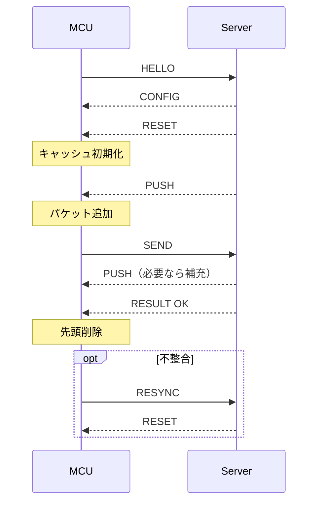

# ノードとパケット

## ノードIDと表示

ノードIDの定義は[node_id.hpp](../src/player/node_id.hpp)、表示名・色・隣接ノードは[node_config.hpp](../src/player/node_config.hpp)で管理する。

| 種別 | 内部ID | 表示名 | 表示色 |
| --- | --- | --- | --- |
| 未設定 | `None = 0` | `?` | 黒 |
| プレイヤー | `P1 = 1` | A | 赤 |
| プレイヤー | `P2 = 2` | B | オレンジ |
| プレイヤー | `P3 = 3` | C | 黄 |
| プレイヤー | `P4 = 4` | D | 緑 |
| プレイヤー | `P5 = 5` | E | シアン |
| プレイヤー | `P6 = 6` | F | 青 |
| プレイヤー | `P7 = 7` | G | 紫 |
| プレイヤー | `P8 = 8` | H | ピンク |
| ボット | `B1 = 9` | I | 白 |
| ボット | `B2 = 10` | J | 灰 |
| ボット | `B3 = 11` | K | 茶 |

`spec.md`のボット表記「1〜3」は、現行画面では「I〜K」に対応する。下部の4ボタンは、次の順番で左から描画する。

| 自ノード | 左端 | 左から2番目 | 左から3番目 | 右端 |
| --- | --- | --- | --- | --- |
| A | B | I | K | H |
| B | C | J | I | A |
| C | D | J | K | B |
| D | E | J | I | C |
| E | F | K | I | D |
| F | G | I | J | E |
| G | H | I | K | F |
| H | A | J | K | G |

# サーバー↔プレイヤーノード間通信インターフェース

## 基本仕様

- 通信経路: USB CDC
- データ形式: JSON Lines (UTF-8, 1行1オブジェクト)
- MCU: ESP32-S3, Arduino(FreeRTOS)
- JSONライブラリ: ArduinoJson 7
- サーバー: Radxa ROCK 3B, 中央集権型で、ゲームロジックを動かしながら全パケットを正本として管理する

## JSON形式

```json
{"type": "string","data": { ... }}
```

### メッセージ一覧

#### MCU → Server

- hello: 接続・識別
  - uid: `ESP.getEfuseMac()`を大文字・ゼロ埋め12桁の16進文字列にした端末識別子

- send: パケットの転送を要求
  - pid: パケットID
  - to: 送信先ノード

- resync: キャッシュ再同期をサーバーに要求

#### Server → MCU

- config: ノードの設定
  - node: ノード

- reset: MCU側キャッシュ全更新
  - packets: 更新後のパケット配列。各要素は`{"pid": 1, "dst": 2}`

- push: MCU側キャッシュ末尾へのパケット追加
  - pid: パケットID
  - dst: 宛先ノード

- result: `send`の処理結果
  - ok: 成功判定(boolean)

### 制約

- `config.node`は1〜8、`pid`は0〜65535、`dst`は1〜11の整数とする。同じキュー内で`pid`を重複させない。
- キャッシュは最大1024件。JSONは改行を除いて1行32768バイトまでとし、CRLFも受け付ける。
- `send`は同時に1件だけ処理する。成功時のみ先頭を削除し、失敗時は残す。
- 応答が3秒以内に来ない場合は追加送信を止めて`resync`を要求する。`reset`が来るまではキャッシュを変更しない。
- 応答に要求IDがないため、サーバーは`send`の結果を順序どおり1回だけ返す。`reset`を返す前に、それ以前の`send`に対する`result`をすべて送出する。`reset`より後へ古い応答を持ち越さない。
- 不正な入力、キューあふれ、重複IDは`resync`の対象とする。不正な`reset`では既存キャッシュを保持する。
- 改行前の受信が1秒間途絶えた場合も`resync`を要求する。大きな行を分割して送る場合は、途中で1秒以上停止しないこと。

### 通信シーケンス


