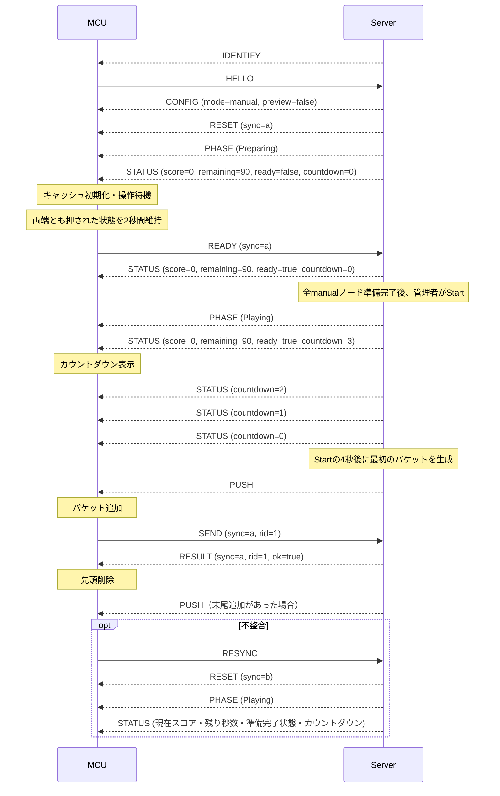

# ノードとパケット

## ノードIDと表示

ノードIDの定義は[node_id.hpp](../../src/player/node_id.hpp)、表示名・色・隣接ノードは[node_config.hpp](../../src/player/node_config.hpp)で管理する。

| 種別 | 内部ID | 表示名 | 表示色 |
| --- | --- | --- | --- |
| 未設定 | `None = 0` | `?` | 黒 |
| プレイヤー | `P1 = 1` | A | 赤 |
| プレイヤー | `P2 = 2` | B | オレンジ |
| プレイヤー | `P3 = 3` | C | 黄 |
| プレイヤー | `P4 = 4` | D | 緑 |
| プレイヤー | `P5 = 5` | E | シアン |
| プレイヤー | `P6 = 6` | F | 青 |
| プレイヤー | `P7 = 7` | G | 紫 |
| プレイヤー | `P8 = 8` | H | ピンク |
| ボット | `B1 = 9` | I | 白 |
| ボット | `B2 = 10` | J | 灰 |
| ボット | `B3 = 11` | K | 茶 |

ボット1〜3は内部IDのB1〜B3、画面の表示名I〜Kに対応する。下部の4ボタンは、次の順番で左から描画する。

| 自ノード | 左端 | 左から2番目 | 左から3番目 | 右端 |
| --- | --- | --- | --- | --- |
| A | B | I | K | H |
| B | C | J | I | A |
| C | D | J | K | B |
| D | E | J | I | C |
| E | F | K | I | D |
| F | G | I | J | E |
| G | H | I | K | F |
| H | A | J | K | G |

# サーバー↔プレイヤーノード間通信インターフェース

## 基本仕様

- 通信経路: USB CDC
- データ形式: JSON Lines (UTF-8, 1行1オブジェクト)
- MCU: ESP32-S3, Arduino(FreeRTOS)
- JSONライブラリ: ArduinoJson 7
- サーバー: Radxa ROCK 3B, 中央集権型で、ゲームロジックを動かしながら全パケットを正本として管理する

本節は接続・識別、操作モードと確認表示の設定、準備完了の要求・通知、FIFO同期、フェーズ・スコア・残り時間・最終結果の通知、および転送要求・応答の通信仕様を定義する。ゲームルールは[ルールの正本](../rules.md)、サーバー側の状態管理は[サーバー仕様](./server.md)に従う。

## JSON形式

```json
{"type":"resync","data":{}}
```

- メッセージ名は小文字とし、大文字・小文字を区別する。`type`は文字列、`data`はオブジェクトを必須とし、引数のない`identify`・`resync`も`"data":{}`を含める。
- 以下に示す各メッセージの引数はすべて必須とする。整数・真偽値・文字列の型変換は行わない。未定義の追加フィールドは無視する。
- 送信時はLFで終端し、受信時はLF・CRLFを受け付ける。空行は無視する。途中で分割された行は終端まで蓄積し、連続する複数行は受信順に処理する。
- 1行の上限は終端のLF・CRLFを除く32768バイトとする。通信路にデバッグログを混在させない。

### メッセージ一覧

#### MCU → Server

- hello: 接続・識別
  - uid: `ESP.getEfuseMac()`を大文字・ゼロ埋め12桁の16進文字列にした端末識別子

- send: パケットの転送を要求
  - sync: 最後に適用した`reset`の同期世代
  - rid: 要求ID
  - pid: パケットID
  - to: 送信先ノード

- resync: キャッシュ再同期をサーバーに要求

- ready: 準備完了を要求。操作モードの変更やゲーム開始は要求しない
  - sync: 最後に適用した`reset`の同期世代

#### Server → MCU

- identify: MCUに操作を停止して`hello`から識別をやり直すよう要求。LEDノードと共通の識別要求

- config: ノードの設定
  - node: ノード
  - mode: サーバー上の現在の操作モード。`manual`または`auto`の文字列
  - preview: 実機の確認表示中か（boolean）。通常はfalse。trueはmodeがautoの場合だけ有効

- phase: 現在のゲームフェーズの通知
  - phase: `Preparing`・`Playing`・`Finished`のいずれかの文字列

- status: 対応付けられたプレイヤーのスコア・準備完了状態と、ゲームの残り時間・開始前のカウントダウンの通知
  - score: 現在スコアの絶対値。0〜2147483647の整数
  - remaining: 残り時間の秒数。0〜ゲーム時間の整数（現行ルールでは0〜90）
  - ready: サーバーが保持する準備完了状態（boolean）。autoノードはfalse
  - countdown: ゲーム時間が始まるまでの秒数。0〜3の整数。カウントダウン中は3・2・1、それ以外は0

- reset: MCU側キャッシュ全更新
  - sync: この`reset`から有効になる同期世代
  - packets: 更新後のパケット配列。各要素は`{"pid": 1, "dst": 2}`

- push: MCU側キャッシュ末尾へのパケット追加
  - pid: パケットID
  - dst: 宛先ノード

- result: `send`の処理結果
  - sync: 対応する`send`の同期世代をそのまま返す
  - rid: 対応する`send`の要求IDをそのまま返す
  - ok: 転送要求の受理判定(boolean)。真の場合は送信元FIFOから先頭を取り除く。最終目的地への配送成功を表す値ではない。

- summary: 対応付けられたプレイヤーの確定済みのゲーム結果。Finishedの通常表示に使用
  - sync: 結果を適用する`reset`の同期世代
  - score: 最終スコア。0〜2147483647の整数
  - rank: ランキング対象者なら1〜8の整数、対象外ならnull
  - eligible: 当該ゲームのランキング対象か（boolean）。現在の操作モードとは独立した確定値
  - topPercent: 過去の対象ゲームを含めた上位何%か。上位50%以内なら1〜50の整数、それ以外はnull。[上位%の規則](../rules.md#上位)に従い、サーバーが決める
  - gameBest: その回のランキング対象者の最高点。0〜2147483647の整数。対象者がいなければnull
  - gameBestNodes: gameBestを取った対象者のノード番号（1〜8の整数）を昇順に重複なく並べた配列。同点なら全員を含む。gameBestがnullなら空配列
  - hourBest: このゲームが終わった時間帯（日本時間の正時で区切る）のベストスコア。0〜2147483647の整数またはnull
  - hourBestStart: hourBestの時間帯の開始の時。日本時間の0〜23の整数。hourBestがnullならnull
  - hourBestMine: hourBestがこのゲームの、この筐体のプレイヤーの結果ならtrue（boolean）
  - allTimeBest: 通算のベストスコア。0〜2147483647の整数またはnull
  - allTimeBestMine: allTimeBestがこのゲームの、この筐体のプレイヤーの結果ならtrue（boolean）

サーバーからの識別要求・同期、MCUからの転送要求、およびサーバーの応答例を以下に示す。各行が独立したメッセージである。

```json
{"type":"identify","data":{}}
{"type":"config","data":{"node":1,"mode":"manual","preview":false}}
{"type":"reset","data":{"sync":"00000000000000000000000000000002","packets":[{"pid":10,"dst":3}]}}
{"type":"phase","data":{"phase":"Playing"}}
{"type":"status","data":{"score":23,"remaining":87,"ready":true,"countdown":0}}
{"type":"send","data":{"sync":"00000000000000000000000000000002","rid":1,"pid":10,"to":2}}
{"type":"result","data":{"sync":"00000000000000000000000000000002","rid":1,"ok":true}}
```

### 制約

- `hello.uid`は大文字の16進文字12桁とする。`config.node`は1〜8、`pid`は0〜65535、`dst`および`send.to`は1〜11の整数とする。同じキュー内で`pid`を重複させない。隣接関係などの転送先の妥当性は、通信形式の検証後にサーバーのゲームロジックが判定する。
- `config.mode`は`manual`・`auto`、`phase.phase`は上記3種類の文字列だけを受け付け、大文字・小文字を区別する。`config.preview`は必須のbooleanとし、trueとmanualの組合せは不正とする。MCUはFIFO同期済みかつ取得済みのフェーズが`Playing`で、有効な`config`の操作モードが`manual`かつpreviewがfalseの場合だけ、新規`send`を送信する。
- `sync`は大文字の16進文字32桁とする。サーバーが各`reset`に新しい一意の識別子を発行し、同じFIFO内容でも再利用しない。ゲームのReset、セッションの再接続、サーバー再起動をまたいでも再利用しない。値の大小には意味を持たせず、一致だけを判定する。
- `rid`は0〜4294967295の整数とし、MCUが新しい`send`ごとに昇順で発行する。採番カウンタはMCU起動時に初期化し、`identify`・`config`・`reset`の受信、`resync`の要求、ゲームのReset、および接続の再確立では巻き戻さない。上限に達した場合は追加の`send`を停止し、MCUを再起動して新しいシリアルセッションを確立する。
- キャッシュは最大1024件。JSONは改行を除いて1行32768バイトまでとし、CRLFも受け付ける。
- `send`は同時に1件だけ処理する。MCUは同期世代・要求ID・送信対象のPIDを応答待ち情報として保持する。`result`の`sync`と`rid`が現在の同期世代および応答待ち情報と一致した場合にのみ適用し、成功時のみ先頭を削除し、失敗時は残す。先頭のPIDが送信対象と一致しない場合は再同期する。
- MCUは`result`の`sync`・`rid`・`ok`を検証する。形式が正しい応答でも、同期世代または要求IDが一致しない場合、応答待ちでない場合、または未設定・同期待ちの場合は無視し、現在のキュー・応答待ち情報・応答タイマーを変更しない。必須フィールドの欠落など、不正な形式は再同期の対象とする。
- 応答が3秒以内に来ない場合は追加送信を止めて`resync`を要求する。`reset`が来るまではキャッシュを変更しない。
- サーバーは形式が正しい新規`send`を受信した時点で、そのセッションの最大要求IDを更新する。ゲーム操作が拒否された場合も要求IDを使用済みとし、`config`・`reset`・`resync`およびゲームのResetでは履歴を消去しない。最初の要求IDは0以上であればよく、番号の欠番を許可する。以降、最大要求ID以下の`send`は無視し、ゲーム操作を再適用せず、応答も重複送信しない。
- サーバーは新規`send`の同期世代と要求IDを付けて`result`を1回返し、接続ごとの送信順序を維持する。MCUは同じ要求IDで再送せず、必要な場合は再同期後に新しい要求IDで操作する。
- サーバーは`reset`の送信キュー登録時に、そのセッションの現在の同期世代を新しい`sync`へ切り替える。FIFOコピーの確定・世代の切替・送信キュー登録は、他の入力イベントを挟まずに行う。登録失敗時はセッションを終了する。MCUへの到着や適用を待ってから切り替えない。
- 現在の同期世代と一致しない新規`send`は、FIFOのPIDが一致しても実行せず、要求に含まれる`sync`・`rid`で`result(ok=false)`だけを返す。既に新しい世代の`reset`が送信順序上で先行しているため、追加の`reset`を送らない。まだ`reset`を発行していないセッションでもゲーム操作を実行しない。
- 正当な`reset`の適用時には応答待ちを取り消し、同期世代とキューを一括で置き換える。以降の`send`には新しい同期世代と新しい要求IDを用いる。旧世代の`send`はサーバーで拒否し、その遅延応答もMCUで無視する。不正な`reset`では既存の同期世代とキャッシュを保持する。
- 不正な入力、キューあふれ、キャッシュ内パケットのPID重複は後述の復旧処理の対象とする。設定を信頼できない場合は`hello`から再識別し、それ以外は`resync`を要求する。不正な`reset`では既存キャッシュを保持する。
- 改行前の受信が1秒間途絶えた場合は、設定変更の有無を判別できないため、操作モードを`auto`へ戻して設定を無効化し、`hello`から再識別する。大きな行を分割して送る場合は、途中で1秒以上停止しないこと。

### 接続・識別と再試行

サーバーは接続先の種別が未確定でも、共通の識別要求`{"type":"identify","data":{}}`を送信する。プレイヤーMCUは本仕様のJSON形式の`hello`、LEDノードは[LEDノード仕様](./led.md)の`HELLO UID`で応答し、サーバーは有効な応答の形式から種別を判別する。以下はプレイヤーMCUと判別された場合の設定・同期と、プレイヤーMCU側の動作を定義する。

| MCUの状態 | MCUの動作 | サーバーの動作 |
|---|---|---|
| identify受信（全状態） | 操作モードをauto、previewをfalseに戻し、設定・同期世代・フェーズ・表示値・最終結果・応答待ちを無効化して操作を停止し、直ちに`hello`を送信 | 新しいセッションで直ちに`identify`を送信し、有効な`hello`を受信するまで1秒間隔で再送 |
| 未設定 | 通信開始時に`hello`を送信し、有効な`config`を受け取るまで1秒間隔で再送 | UIDを識別する。割当済みの場合は`config`、現在のFIFOの`reset`、現在の`phase`・`status`の順に送信 |
| 設定済み・同期待ち | `resync`を要求し、有効な`reset`を受け取るまで1秒間隔で再送 | 割当済みの場合は現在のFIFOの`reset`、現在の`phase`・`status`の順に送信 |
| FIFO同期済み・フェーズ未取得 | `send`を送信せず、フェーズを取得するまで1秒間隔で`resync`を要求 | 現在のFIFOの`reset`、現在の`phase`・`status`の順に送信 |
| FIFO同期済み・フェーズ取得済み・表示情報取得待ち | 下記の表示情報取得待ちの規則に従い、3秒以内に有効な`status`を取得できなければ同期待ちへ移り、`resync`を要求 | 現在のFIFOの`reset`、現在の`phase`・`status`の順に送信 |
| FIFO同期済み・フェーズ取得済み・表示情報取得完了 | `push`・`result`・`phase`・`status`を適用。manualの場合、Preparingでは長押しで`ready`、Playingではボタン操作で`send`を送信 | ゲーム状態の変更と準備完了・転送要求に応じて通知・応答を送信 |
| 通常表示・FIFO同期済み・Finished・結果未取得 | 「確定結果の通知」の規則に従って`summary`を待ち、3秒以内に取得できなければ`resync`を要求 | 現在のFIFOの`reset`、`phase(Finished)`、`status`、新しい同期世代の`summary`の順に送信 |

previewのMCU内の初期値はfalseとし、通常の設定も`config.preview=false`とする。この表の初期同期・再同期の応答は、Finishedの通常表示では末尾に`summary`を追加する。確認表示の設定・解除は「実機の確認表示」に従う。STATUSの取得完了と最終結果の取得完了は別に判定する。

初期設定およびMCUが`resync`で開始した再同期では、同期用の有効な`reset`を適用した後に有効な`status`を受信するまで、表示情報取得待ちとする。FIFO同期とフェーズ取得が両方成立した時点から3秒以内に取得できなければ、既存の同期待ちへ移って`resync`を要求し、以後は同期待ちの1秒間隔の再試行に従う。同じ取得待ちの間、他のメッセージやフェーズの再通知、通常のFIFO更新の`reset`で期限を延長しない。

表示情報の取得完了は同期ごとに判定し、以前に取得済みの表示値を保持しているかどうかと区別する。同じ値の`status`でも、その同期用の`reset`適用後に受信したものであれば取得完了となる。通常のFIFO更新の`reset`だけでは新たな表示情報取得待ちに入らない。表示情報取得待ちの間も、`push`・`result`・`phase`・`status`を既存の規則で適用し、`send`・`ready`の許可条件に追加の制限を設けない。タイムアウト後は同期待ちの操作停止規則に従う。

初めて識別されたUIDには、サーバー仕様の規則に従いPreparing・Finishedで空いているP1〜P8を自動で仮割当し、`config(mode=auto, preview=false)`、`reset`、`phase`、`status`の順に初期同期する。Finishedなら続けて`summary`を送る。MCUは割当先の表示名A〜Hと表示色を表示し、管理者が現実の配置と照合してWeb管理画面から割当を変更・交換する。仮割当専用の通信メッセージや確定操作は設けない。

空きがない場合、Playing中の初回接続、および管理操作で未割当になったUIDは、サーバー仕様の条件に従って未割当で待機する。サーバーは識別情報と接続状態をWeb管理画面に公開する。割当が成立した時点で初期同期する。後述の実機確認では、未割当のまま一時的な表示用設定を送ることができる。切断だけでは対応を解除せず、再接続では現在の対応表を用いる。予備基板への交換で割当を失った旧UIDが再接続しても、旧ノードを自動で取り戻さない。

割当の変更・交換・予備基板への付け替えはPreparing・Finishedでのみ行い、担当UIDが実際に変わるプレイヤーノードはauto・準備未完了とする。新しい担当MCUへ上記の初期同期を行い、ノードIDとモードを一括で再設定する。担当を失って未割当になる接続済みMCUへは`identify`を送り、設定・表示・応答待ちを無効化して操作を停止させる。以後の`hello`で自動仮割当せず、管理操作を待つ。

対応表と自動仮割当の対象外UIDは、[サーバー仕様の保存・復元手順](./server.md#423-デバイス対応表の保存復元)に従って再起動後も復元する。自動仮割当を含む割当変更では、保存成功後に変更対象の確認表示を解除し、割当・操作モード・準備完了状態を確定してからMCUを再設定する。旧担当の表示復旧は省略する。保存失敗時は操作に伴う変更を行わず、置換前の失敗なら自動仮割当は未割当で待機する。置換後の親ディレクトリ同期失敗ではサーバー仕様に従ってサーバーを停止する。サーバー再起動時は保存済みの機器も未接続として扱い、接続・識別後に通常の初期同期を行う。全プレイヤーはauto・未準備から開始し、確認表示を再開しない。

`identify`を繰り返し受信した場合も`hello`を返すが、MCUの要求IDカウンタは維持する。サーバーは有効な`hello`を受信した時点で`identify`の再送を停止する。HELLO待ちに届いた旧`send`・`ready`・`resync`は無視し、ゲーム操作・要求IDの履歴に反映せず、セッションを切断しない。

同じセッションから同じUIDの`hello`を繰り返し受信しても、新しいセッションを作らず、要求IDの履歴を維持して設定・同期を再実行する。同じセッションで異なるUIDを名乗った場合はセッションを終了する。異なるセッション間のUID重複はサーバー仕様の規則に従う。

有効な`config`を受け取ったMCUはnode・mode・previewを検証してから一括で反映し、フェーズ・表示値・最終結果を未取得に戻し、応答待ちを取り消して同期待ちに入る。有効な`reset`と`phase`を受け取ってから、フェーズと操作モードに応じて操作を許可する。未設定・同期待ちでは`send`・`ready`を送らず、`push`は適用しない。未設定で受け取った`reset`・`phase`・`status`・`summary`も適用せず、`hello`を継続する。`config`・`reset`・`push`・`phase`・`status`・`summary`への受信確認メッセージは設けない。

MCUがUSB CDCの未接続を100ms連続して検出した場合は、設定・同期世代・フェーズ・表示値・最終結果・応答待ち・受信中の行を破棄し、previewをfalseに戻して再接続後は`hello`から開始する。短時間の切断をMCUが検出できなくても、サーバーの新しいセッションからの`identify`によって識別を再開する。サーバーは旧セッションの受信途中のデータと未送信メッセージを破棄し、旧Session IDからのイベントを新しいセッションへ引き継がない。FIFO同期・フェーズ取得・表示情報取得が完了し、Finishedの通常表示では最終結果も取得済みで、転送要求の応答待ちや準備完了要求の確認待ちがない正常な無通信状態には、タイムアウトを設けない。

### 操作モードの設定

操作モードの正本はサーバーとし、MCUの初期値は`auto`とする。起動時、`identify`受信時、および切断を検出した場合は`auto`へ戻す。`config.mode`は毎回明記する必須フィールドとし、有効な`config(mode=manual)`を受け取った場合だけMCUは手動入力を有効にできる。モードはMCU内でのパケット自動転送を指示する値ではなく、`auto`の転送処理もサーバーが行う。

管理画面からの手動・自動切替はPreparing・Finishedでのみ受け付ける。サーバーでモードを変更した場合は、接続済みの対象MCUへ`config(preview=false)`、現在のFIFOの`reset`、現在の`phase`、現在の`status`の順に再設定する。Finishedなら続けて`summary`を送る。Playing中は管理操作による切替を拒否し、切断時のみサーバー上のノードを自動操作へ切り替える。

再接続後もサーバーは自動操作を維持し、現在のモードである`auto`を`config`で通知する。Playing中に再接続しても手動操作へは戻さない。Preparing・Finishedで管理者が手動操作へ切り替えた場合は`manual`を通知する。Playing中の識別・再接続・同じUIDのHELLO再受信でも`config`は受け付けるが、新たなモード切替を指示するのではなく、その時点のサーバー上のモードを通知する。

FIFOの`reset`、ゲームのReset、`phase`、`status`では保持中の操作モードを変更しない。`auto`のMCUもFIFO・フェーズ・スコア・残り時間を同期・表示するが、ボタン操作による`send`は送らない。専用のモード通知メッセージやMCUからの切替要求は設けない。

不正な`config`ではnode・mode・previewを部分的に反映しない。モードを`auto`、previewをfalseへ戻して設定・同期世代・フェーズ・表示値・最終結果・応答待ちを無効化し、`hello`から再識別する。JSONを復号できない場合や、行上限超過・行途中の1秒間の受信停止により設定変更の有無を判別できない場合も同じ扱いとする。`mode`・`preview`の欠落を暗黙の値や正常な設定として扱わない。

### 準備完了の要求と通知

準備完了はサーバーがプレイヤーノードごとに保持し、操作モード、FIFO同期状態、フェーズとは独立して管理する。初期値はfalseとし、autoノードは常にfalseとする。Preparing中のmanualノードだけが`ready`を要求できる。全員の準備完了だけではゲームを開始せず、開始は管理者の`Start`操作による。

MCUは設定・FIFO同期済みかつ取得済みフェーズがPreparingで、操作モードがmanualの場合、デバウンス後に両端とも押された状態になった時点から計測を開始し、その状態が2秒間続いたら`ready`を1回送信する。押し始めのタイミングが一致する必要はない。途中で片方でも離した場合は計測を解除する。成立後は両端とも離された状態を確認するまで再通知せず、受理済みの場合は再度の長押しでも取り消さない。内側の2ボタンの押下状態は判定に使用しない。

`ready.sync`の形式は`reset.sync`と同じとする。サーバーは現在の有効なSession ID、識別・割当、Preparing、manual、および当該セッションの現在の同期世代との一致を確認してから準備完了をtrueにする。同期世代はゲームのResetで更新するため、前のゲームから遅れて到着した要求を次の準備へ適用しない。`ready`は`send`の要求IDを消費せず、FIFO・スコア・操作モードを変更しない。同じ要求を重複して受理してもtrueのままとする。

割当済みの有効なセッションから形式が正しい`ready`を受信した場合、サーバーは受理・拒否・重複のいずれでも現在の`status`を返す。値が変わらなくても通知し、`result`は返さない。同期世代不一致、Preparing以外、またはautoの場合は準備完了を変更しない。未割当の識別済みMCUからの要求は無視し、対応付けを待つ。不正な形式は既存の不正データ処理に従う。

```json
{"type":"ready","data":{"sync":"00000000000000000000000000000002"}}
{"type":"status","data":{"score":0,"remaining":90,"ready":true,"countdown":0}}
```

MCUは長押し中の進捗と要求後の「通知中」を表示し、`status.ready=true`を受け取ってから「準備完了」と表示する。3秒以内にtrueを確認できなければ`resync`でサーバーの最新状態を取得し、要求を自動再送しない。復旧後もfalseの場合は再度の長押しで要求する。フェーズ・モードの変更、`identify`・`config`・`reset`の受信、切断・復旧処理への移行では長押し計測と準備完了要求の確認待ちを解除し、両端を一度離してから次の計測を許可する。押したままの操作を次ゲームへ持ち越さない。

サーバー上の準備完了はゲームのResetで全員falseにし、切断・割当変更・操作モード変更では対象ノードをfalseにする。通常のFIFO再同期や同じ設定の再通知では保持し、現在値を`status`で復元する。MCUで設定を無効化した場合は準備完了の表示も未取得に戻し、有効な`status`で再取得する。FIFOの`reset`だけでは取得済みの準備完了表示を変更しない。Playing・Finishedでは保持中の値を表示情報として扱い、ゲーム進行へ影響させない。

### フェーズ通知

サーバーはStart、Finish、ゲーム時間終了、およびゲームのResetによるフェーズ変更を、接続・識別・割当済みのプレイヤーMCUへ`phase`で通知する。自動操作中のプレイヤーMCUも通知対象とする。

MCUは取得済みフェーズを同期世代と別に保持する。起動時および`identify`・`config`受信時は未取得とし、フェーズを取得するまで新規`send`を送らない。設定済みであれば同期待ちでも`phase`を保存し、表示へ反映する。`Preparing`・`Finished`または操作モードが`auto`の場合は新規`send`を停止する。フェーズ通知だけではFIFO・同期世代・処理中の転送要求（`send`）の応答待ちを変更せず、受信した`result`はフェーズによらず既存の同期世代・要求IDの照合規則で適用する。準備完了要求（`ready`）の確認待ちは、フェーズが変更された場合に解除する。

FIFOの`reset`は保持中のフェーズを変更しない。初期同期・再同期時はFIFOの`reset`に続けて現在の`phase`、`status`を送り、ゲームのResetでは`phase(Preparing)`、空FIFOの`reset`、初期値の`status`の順に送る。関連する通知は同じ確定状態から生成し、接続ごとの送信順序を維持する。フェーズの受信によって生成・転送・得点などのゲームルールをMCU側で実行しない。

### スコア・残り時間・準備完了状態・カウントダウンの通知

`status`は通知先MCUに対応付けられたプレイヤーの現在スコア・準備完了状態と、全プレイヤー共通の残り時間・カウントダウンを、同じ確定状態から取得して送信する。`score`・`remaining`・`ready`・`countdown`の4項目を毎回含め、加点差分ではなく現在値で通知する。自動操作中のプレイヤーも同じ方法で通知し、通知自体はランキング対象の判定や操作モードを変更しない。

| フェーズ | score | remaining | countdown |
|---|---|---|---|
| Preparing | 0 | ゲーム時間の秒数（現行90） | 0 |
| Playing | ゲームルールに従う現在スコア | 残り時間の端数を切り上げた秒数。カウントダウン中はゲーム時間の秒数 | カウントダウン中は3・2・1、以後0 |
| Finished | 確定した最終スコア | 終了時点の残り秒数を保持。時間満了なら0、手動Finishならその時点の残り秒数 | 0 |

`ready`は「準備完了の要求と通知」で定める状態を各フェーズで通知する。Playing・Finishedへの遷移だけでは解除せず、ゲームのResetではfalseにする。autoノードには常にfalseを通知する。

Startの受理から3秒間はカウントダウンとし、その終了時刻をゲーム時間の起点とする（[サーバー仕様](./server.md)3.1）。カウントダウンはPlayingの一部であり、`phase`は`Playing`のまま通知する。`countdown`は`ceil(起点 - 現在時刻)`でサーバーが計算し、Startの受理直後から1秒未満までは3、2秒後から3秒未満までは1、起点以後は0となる。カウントダウン中はパケットの生成・転送・得点を行わないため、FIFOは空のままであり、`send`は受理されない。

Playing中の残り秒数は、`ceil(max(0, ゲーム時間 - 経過時間))`でサーバーが計算する。カウントダウン中の経過時間は0とする。例えばカウントダウン中と、起点から1秒未満までは90、起点の1秒後は89となる。ゲーム内時間と終了判定の正本はサーバーとし、MCUは独自のカウントダウンを行わない。

サーバーは初期設定・再接続・再同期・フェーズ変更時と、割当済みの有効なセッションから形式が正しい`ready`を受信した場合に、値が直前と同じでも`status`を送信する。それ以外では、入力イベント確定後にスコア・通知する残り秒数・準備完了状態・カウントダウンのいずれかが変わったプレイヤーMCUにだけ送信する。カウントダウンは3→2→1→0の各変化で1回ずつ通知する。残り時間の表示更新は通常1秒ごととなり、100msごとの同一値の通知は行わない。Tickが遅延した場合は処理確定後の最新値を通知し、途中の表示値をすべて再送しない。

MCUは受信した`status`の4フィールドの型・範囲をすべて検証してから、表示値を一括で置き換える。`ready`の欠落やboolean以外の値、`countdown`の欠落や0〜3以外の値も不正とする。設定済みであればFIFOの同期待ちでも保存でき、同じ値の再通知も受け付ける。スコアが減った値も、ゲームのResetなどによる正本の更新として受け付ける。不正な`status`では以前の表示値を保持し、既存の不正データ処理に従って再同期する。

`countdown`は後から追加した項目である。追加前のMCUは`status`の未知の項目を無視するため、サーバーを先に配布し、MCUを後から更新する。この順であれば、追加前のMCUはカウントダウンを表示しないだけで、通信は継続する。

初期設定・再同期での`status`の未取得は、「接続・識別と再試行」の表示情報取得待ちの規則で復旧する。取得済みの表示値がある場合も、再同期では新しい`status`の受信を確認する。通常動作中の`status`の受信間隔を監視するタイムアウトは設けない。

起動時、`identify`・`config`受信時、および切断を検出した場合はスコア・残り時間・準備完了表示を未取得とし、以前の割当先の値を表示し続けない。FIFOの`reset`は保持中の表示値を変更せず、`status`だけではFIFO・同期世代・フェーズ・操作モード・要求ID・転送要求の応答待ちを変更しない。準備完了要求の確認待ちは「準備完了の要求と通知」の規則に従う。MCUは独自に加点せず、残り時間が0という理由だけでフェーズを変更しない。SENDの許可条件はFIFO同期状態・フェーズ・操作モードの規則に従い、`status.ready`による追加の制限は行わない。

`phase`と組み合わせる場合は`phase`、`status`の順に送信する。ゲームのResetでは`phase(Preparing)`、新しい同期世代の空FIFOの`reset`、`status(score=0, remaining=ゲーム時間, ready=false, countdown=0)`の順とする。再同期によりFIFO・フェーズとスコア・残り時間・準備完了・カウントダウンの表示をまとめて復旧できる。

### 確定結果の通知

サーバーはFinishedへの遷移時に、全プレイヤーの最終スコア・ランキング資格・順位・上位%と、筐体へ送るベストスコアを同じ確定状態から決定する。順位の計算は[最終順位の規則](../rules.md#最終順位)に従い、ランキング対象外のプレイヤーを順位計算にも人数にも含めない。上位%の計算は[上位%の規則](../rules.md#上位)に従い、過去のゲームの記録を持つサーバーだけが求める。MCUは通知された順位と上位%を表示し、現在の`config.mode`や他プレイヤーのスコアから独自に算出しない。

Finishedへの遷移時は、接続・識別・割当済みで通常表示のMCUへ`phase(Finished)`、`status`、`summary`の順に送信する。Finished中の初期同期・再接続・再設定では`config(preview=false)`、新しい同期世代の`reset`、`phase(Finished)`、`status`、`summary`の順に送る。Finishedの通常表示中に`reset`を送る場合も、その後に`phase`、`status`、新しい同期世代の`summary`を続ける。現在の`status.score`と`summary.score`は同じ確定スコアを通知する。再同期・再接続・モード変更・基板交換で確定結果を変更しない。

```json
{"type":"phase","data":{"phase":"Finished"}}
{"type":"status","data":{"score":345,"remaining":0,"ready":true,"countdown":0}}
{"type":"summary","data":{"sync":"00000000000000000000000000000002","score":345,"rank":2,"eligible":true,"topPercent":12,"gameBest":410,"gameBestNodes":[3],"hourBest":410,"hourBestStart":13,"hourBestMine":false,"allTimeBest":520,"allTimeBestMine":false}}
```

対象外の場合は、例えば`score=400, rank=null, eligible=false, topPercent=null`とし、スコアを保持して順位と上位%を付けない。全フィールドは必須とする。`summary.sync`の形式は`reset.sync`と同じで、`eligible=true`なら`rank`は1〜8の整数、falseならnullでなければ不正とする。`topPercent`は1〜50の整数またはnullとし、`eligible=false`ではnullでなければ不正とする。`eligible=true`ではnullも整数も正しい。上位50%を超える人、手動の終了、およびサーバーが過去の記録を使えないときは、`eligible=true`でも`topPercent`はnullになる。MCUはsync・score・rank・eligible・topPercentと、後述のベストスコアの項目の型・範囲・組合せを検証してから一括で適用する。

ベストスコアの項目（gameBest、gameBestNodes、hourBest、hourBestStart、hourBestMine、allTimeBest、allTimeBestMine）は、[ベストスコアの規則](../rules.md#ベストスコア)に従ってサーバーが決め、Finishedへの遷移時に順位と同じ確定状態から1回だけ求めて、以後は変えない。値は[サーバー仕様](./server.md#357-プレイヤーへ送るベストスコア)の3.5.7に従う。組合せは次のとおりとし、満たさない`summary`は不正とする。

- `gameBest`がnullなら`gameBestNodes`は空配列、整数なら`gameBestNodes`は1〜8個の要素を持つ。
- `hourBest`がnullなら`hourBestStart`はnull、整数なら`hourBestStart`は0〜23の整数とする。
- `hourBestMine`が`true`なら、`eligible=true`で、`hourBest`は`score`と等しい。`allTimeBestMine`と`allTimeBest`も同じとする。`hourBest`・`allTimeBest`がnullなら、対応する`*Mine`は`false`とする。
- `eligible=false`のプレイヤーにも、その回・時間帯・通算のベストスコアを送る。`*Mine`は`false`になる。

時間帯のベストは、このゲームが終わった時間帯のものとし、今回の結果が1時間ごとの集計の対象なら今回の結果も含める。手動で終了したゲームなど対象でない場合は、今回の結果を含めない値になり、その時間帯に対象の結果がなければ`hourBest`と`hourBestStart`はnullになる。通算も同じく、対象の結果がなければnullになる。サーバーが過去の記録を使えない起動では、`hourBest`・`hourBestStart`・`allTimeBest`をnull、`hourBestMine`・`allTimeBestMine`を`false`とし、`gameBest`・`gameBestNodes`だけを送る。MCUはnullのベストを「---」などの値なしとして表示する。

これらの項目は`summary.data`の直下に平らに置き、配列は`gameBestNodes`の1段だけとする。`summary`全体のJSONの入れ子の深さは3（メッセージ、`data`、`gameBestNodes`）である。既存のファームウェアはJSONの入れ子の深さを4までに制限しており、それを超えるメッセージを受け取ると設定を捨てて再識別するため、`bests: {game: {...}}`のような入れ子にはしない。

`topPercent`とベストスコアの項目は、それらを知らない既存のファームウェアが無視する追加の項目である。そのため、サーバーを先に更新してから、ファームウェアを更新してよい。不正な`summary`では既存の正常値を保持して再同期する。形式が正しくても、未設定・FIFO同期待ち・Finished以外・確認表示中の場合や、適用済み`reset`の同期世代と一致しない場合は無視する。

通常表示でFIFO同期とFinishedの取得が両方成立してから3秒以内に、その同期世代の有効な`summary`を取得できなければ`resync`で復旧する。取得待ち中は`phase`・`status`の再通知や通常の`reset`で期限を延長しない。復旧の同期待ちでは既存の1秒間隔の再試行に従い、次の同期が成立してから改めて取得期限を開始する。結果取得済みの正常な無通信状態にはタイムアウトを設けない。

MCUは`identify`・`config`・切断確定時、およびFinishedから他フェーズへ移るときに結果を無効化する。`reset`で同期世代が変わった場合は、新しい世代の結果を再取得する。`status`や転送応答の`result`だけで最終結果を確定せず、以前のゲーム・割当先のスコアや順位を結果として表示しない。サーバーはPreparing・Playing、確認表示中、および未割当MCUへの`summary`を送らない。

### フェーズごとの画面

設定・FIFO・フェーズが揃うまでは、接続・同期状態の表示を優先して手動操作を停止する。通常表示は取得済みフェーズによって切り替え、パケットが降る画面はPlayingでだけ表示する。各画面でも割当先の表示名・色を識別できるようにする。Preparing・FinishedでもFIFOなどの通信状態は通常どおり同期する。表示値が未取得の場合は取得中であることを示す。表示情報取得待ち中の操作許可条件は「接続・識別と再試行」の規則に従う。

Preparingの表示と長押し操作は以下とする。長押し・要求・応答の判定と復旧条件は「準備完了の要求と通知」に従う。

| 状態 | 表示 |
|---|---|
| manual・未準備 | `Press and hold both end buttons.`、空のバー、実際の両端ボタンを指す矢印 |
| 両端の長押し中 | デバウンス後の経過時間に応じて2秒でバーを満たす。片方を離したら空へ戻す |
| ready送信後・受理未確認 | 満タンのバーと`CONFIRMING...`。満タンだけで準備完了としない |
| status.ready=true | `READY`と`Waiting for the administrator to start.`。受理済みの準備完了を再通知で取り消さない |
| auto | `AUTO`と開始待ちの表示。長押し案内と操作用の矢印は表示しない |

再同期で準備完了を取得した場合も開始待ちの表示を復元する。MCUの表示や長押し操作で操作モードを変更せず、全員の準備完了だけでPlayingへ自動遷移しない。

Playingで`status.countdown`が1以上の間は、ゲーム開始までのカウントダウンとして、通知された数字（3・2・1）を大きく表示する。MCUは数字を独自に減らさず、`status`を受け取るたびに表示を置き換え、0を受け取ったら通常のPlaying画面に戻す。`countdown`が未取得の間は通常のPlaying画面とする。数字の大きさや演出は本仕様で固定しない。

Finishedでは有効な`summary`の取得までは結果取得中とし、確定した最終スコアと順位を表示する。対象外はスコアと`NOT RANKED`を表示する。`topPercent`がnullのときは上位%を表示せず、スコアと順位だけを表示する。整数のときの表示内容は本仕様では固定しない。通常のPlayingからFinishedへの遷移で初めて結果を取得した場合に終了演出を行い、同じ結果の再通知では繰り返さない。Finished中の再接続・復旧では静止した結果画面を復元する。演出の内容・時間・具体的な描画手法は本仕様で固定しない。演出中も通信処理を継続し、Reset・再識別・フェーズ変更などに応じて表示を切り替える。画面内の演出のために`Finishing`などの通信フェーズは追加しない。結果画面のページ送りは次の「結果の表示」に従う。

#### 結果の表示

Finishedで有効な`summary`を取得した後の結果画面は、次のページで構成する。右端のボタン（下部の4ボタンの枠のうち右端、x=360〜479）を押した瞬間（デバウンス後の押下の立ち上がり）に次のページへ進み、③の次は①へ戻る。

| ページ | 表示 |
|---|---|
| ① スコアと順位 | 確定した最終スコアと順位。対象外は`NOT RANKED` |
| ② 上位% | `topPercent`の値。`topPercent`がnull（下位50%と対象外）なら②を飛ばし、①の次を③とする |
| ③ ベストスコア | その回・時間帯・通算のベストスコアの3行 |

- ページは筐体だけの表示状態とし、ページ送りではサーバーへ何も送らない。操作モード（manual・auto）に関係なく送れる。
- Finishedでは、右端以外の3つのボタンは何もしない。ボタンによる`send`はPlayingでだけ送る。
- 右端のボタンの枠には`NEXT`、大きな右向きの矢印、ページの位置を示す点を描く。点は実際に送れるページの数（`topPercent`がnullなら2つ、整数なら3つ）だけ並べ、現在のページを塗る。他の3つの枠は空にする。
- 終了演出は①で行う。演出中に押した場合は、演出を終えて次のページへ進む。①へ戻ったとき、およびFinished中の再接続・復旧で取得した結果では静止画とし、演出を繰り返さない。
- 結果を取得していない間（同期待ち・STATUSの取得待ち・結果の取得待ち）の押下ではページを送らない。
- 次の場合はページを①へ戻す: Finishedに入ったとき、`summary.sync`が変わったとき（新しい同期世代の結果を取得したとき）、`identify`・`config`を受けたとき。
- Finished以外のフェーズ（ゲームのResetでPreparingになった場合を含む）では、ページの状態を使わず、そのフェーズの画面を表示する。全員が結果を見終わっていなくても、管理画面のResetで準備画面へ戻る。

③は画面のボタン枠より上（y=81〜239）に、次の3行を描く。文字はFont0だけを使い、日本語は使わない。

| 行 | 見出し | 行頭の絵 | 値 |
|---|---|---|---|
| その回 | `THIS GAME` | 旗 | `gameBest`。続けて`gameBestNodes`の各ノードの表示名（A〜H）を、そのノードの色の札で並べる |
| 時間帯 | `hourBestStart`の時間帯（例: `13:00-13:59`）。`hourBestStart`がnullなら`THIS HOUR` | 時計 | `hourBest` |
| 通算 | `ALL TIME` | 王冠 | `allTimeBest` |

- 行頭の絵は8×8のドット絵を3倍に拡大して描き、英語が読めなくても3行を区別できるようにする。
- 値は大きく表示し、nullなら`---`とする。
- 自分のベストの行は、自ノードの色の枠と見出しで強調し、`YOU!`を表示する。その回の行は`gameBestNodes`に自ノードが含まれる場合、時間帯・通算の行は`hourBestMine`・`allTimeBestMine`がtrueの場合とする。

確認表示中は、以下の「実機の確認表示」を優先する。

### 実機の確認表示

Preparing・Finishedで接続・識別済みMCUを、管理画面から確認対象として選択できる。割当済みの場合は操作モードがautoの対象に限り、未割当の予備基板も対象にできる。対象はLED制御MCUと合わせてサーバー全体で1台とし、開始・停止は[サーバー仕様の実機確認](./server.md#422-実機の確認表示)に従う。プレイヤーMCUには`config.preview=true`を通知する。`identify`は通信上の再識別要求として使用する。

確認用ノードIDは、割当済みなら現在の担当、未割当ならP1とする。未割当への`config(node=1, mode=auto, preview=true)`は一時的な表示用設定であり、正式な対応表へ登録せず、既存P1の担当・操作モード・ゲーム状態を変更しない。MCUは通常の`config`として受け付けるが、サーバーは一時設定をゲーム操作の受理や通常通知の送信先として使わない。

開始時は確認用ノードIDの`config(mode=auto, preview=true)`、新しい同期世代の`reset`、現在の`phase`、確認用の`status`を順に送る。`reset.packets`は割当済みなら現在の正本FIFO、未割当なら空配列とする。

```json
{"type":"config","data":{"node":1,"mode":"auto","preview":true}}
{"type":"reset","data":{"sync":"00000000000000000000000000000003","packets":[]}}
```

設定・FIFO・フェーズ取得後、MCUはPreparing・Finishedの通常画面に代えて、確認用ノードの表示名と色を大きく点滅させる。確認中は長押し計測と`send`・`ready`を停止する。`phase`は実際のゲームフェーズを通知し、`status`は割当済みなら現在の担当の正本値、未割当なら表示専用の`score=0`・`ready=false`と実際のゲームの残り秒数・カウントダウンを通知する。未割当への通知に正式なP1の値を用いず、確認画面ではスコア・順位を表示しない。確認中は`summary`を送らず、結果取得待ちも開始しない。

確認表示のためのダミーパケットは生成・送信せず、FIFO・パケット管理・PID採番・生成数・得点・ランキング資格を変更しない。確認表示をPIDの値から判定しない。同期世代の発行・更新・照合規則は通常どおりとする。

割当済みMCUの確認終了時は、現在の担当・操作モードの`config(preview=false)`、新しい同期世代の正本FIFOの`reset`、現在の`phase`、現在の`status`の順に送信して通常表示へ戻す。Finishedなら続けて新しい同期世代の`summary`を送る。未割当MCUには`identify`を送り、一時設定・表示・同期状態を無効化して未設定へ戻す。`hello`再受信や`resync`による確認終了でも、先に確認対象を解除してからこの手順を行い、その後の`hello`で確認表示を再開しない。

対象の切替、手動操作への切替、割当変更（未割当MCUへの正式な割当も含む）、ゲーム開始・Reset、およびHELLO・RESYNCによる設定・同期時も、サーバー仕様に従って終了する。新しいモード・割当やReset後の正本を通常の設定・同期で通知する場合は、その通知を復旧処理として用いる。確認表示だけを理由に正式なP1へ対応付けたり、自動仮割当の対象外UID情報を変更したりしない。切断後の再接続では確認表示を再開しない。

### FIFO同期と送信順序

割当済みMCUへの`reset.packets`は、確認表示中も含めて送信元となるサーバーFIFO全体を、先頭から末尾の順で表す。空のFIFOと未割当MCUの一時的な確認表示には空配列`[]`を使用する。MCUは容量・全要素の形式・PIDの一意性を検証してから、一括でキューを置き換える。

| 契機 | サーバーからの送信 |
|---|---|
| 新しいセッションの開始 | `identify`。有効な`hello`を受信するまで再送 |
| 初期設定・対応付け変更 | `config(preview=false)` → 現在のFIFOの`reset` → 現在の`phase` → 現在の`status` |
| 実機確認の開始 | `config(mode=auto, preview=true)` → 割当済みなら正本FIFO、未割当なら空配列の新しい同期世代の`reset` → 現在の`phase` → 確認用の`status` |
| 実機確認の終了 | 割当済みなら`config(preview=false)` → 新しい同期世代の正本FIFOの`reset` → 現在の`phase` → 現在の`status`。未割当なら`identify`で一時設定を解除。通常の再設定で復旧する場合は重複不要 |
| Preparing・Finishedでの操作モード変更 | 現在のモードの`config(preview=false)` → 現在のFIFOの`reset` → 現在の`phase` → 現在の`status` |
| 通常表示中の割当済みMCUからの`resync` | 現在のFIFOの`reset` → 現在の`phase` → 現在の`status`。確認中なら確認終了の手順を使用 |
| フェーズ変更（ゲームのResetを除く） | 接続・識別・割当済みのプレイヤーMCUへ`phase` → 現在の`status` |
| スコア・残り秒数・準備完了状態・カウントダウンの変更 | 対象プレイヤーMCUへ最新の`status` |
| 割当済みの有効なセッションから形式が正しい`ready`を受信 | 受理・拒否・重複にかかわらず現在の`status` |
| パケット生成・他ノードからの受信による末尾追加 | 対象MCUへFIFO順に`push` |
| 正当な`send`の受理 | 送信元へ`result(ok=true)`。送信元の先頭削除を追加の`reset`で重複通知しない |
| 同期世代不一致による新規`send`の拒否 | 要求の`sync`・`rid`で`result(ok=false)`のみ。追加の`reset`は不要 |
| 同期世代が一致した新規`send`のFIFO・ゲーム状態による拒否 | `result(ok=false)` → 新しい同期世代と現在のFIFOの`reset` |
| 自動転送など、MCUの`send`以外によるキューの削除 | 変更後のFIFOの`reset` |
| ゲームのReset | `phase(Preparing)` → 空配列の`reset` → 初期値の`status`。確認中の割当済みMCUには先に`config(preview=false)`を追加。未割当の確認対象には`identify`を送る |
| 対応付け解除・基板交換で未割当になるMCU | `identify`で旧設定・表示・操作を無効化。以後、対応付けまでゲーム情報を追加しない |

Finishedの通常表示では、上表の同期手順の`status`の後に、その同期世代の`summary`を追加する。Finishedへのフェーズ変更は`phase(Finished)` → `status` → `summary`とする。通常表示中に表の他の契機で`reset`だけを送る場合も、Finishedなら続けて`phase(Finished)` → `status` → 新しい同期世代の`summary`を送る。確認表示中と未割当MCUには`summary`を送らない。

新規`send`を拒否した場合はゲーム上のFIFOを変更しない。同期世代が一致しており、割当済みであれば応答後に新しい世代の正本のFIFOで再同期する。未割当の識別済みMCUからの新規`send`には、要求の`sync`・`rid`で`result(ok=false)`だけを返す。未割当のMCUからの`resync`は、実機確認中なら確認表示を終了して`identify`で一時設定を解除し、それ以外は状態を変更せず対応付けを待つ。

同じ`send`処理で送信元へ`push`などの追加通知が必要な場合は、`result`を先に送信キューへ登録する。転送先がプレイヤーFIFOへ追加される場合は、そのMCUへ`push`を送る。配送完了または破棄によりパケットが消滅する場合は、転送先へ`push`を送らない。

`reset`には送信順序上のその時点までの状態変更を含め、それより後の状態変更を後続の`push`または`reset`で通知する。`reset`に含めた末尾追加を、後続の`push`で重複通知しない。状態通知の復旧には新しい正本の`reset`を用い、`push`や成功した`result`を再送しない。

RESETと転送要求が行き違う場合の処理例を以下に示す。`a`・`b`は異なる同期世代とする。

| 順序 | 処理と状態 |
|---|---|
| 1 | MCUが`send(sync=a, rid=1, pid=10)`を送信。サーバーには未到着 |
| 2 | サーバーがFIFO`[10]`の`reset(sync=b)`を送信キューへ登録し、現在世代をbへ切り替える |
| 3 | MCUがRESETを適用して旧要求の応答待ちを取り消し、FIFO`[10]`を保持 |
| 4 | サーバーが旧SENDを受信。世代不一致として実行せず、`result(sync=a, rid=1, ok=false)`のみ送信。FIFO`[10]`を維持 |
| 5 | MCUが旧RESULTを無視。新しい`send(sync=b, rid=2, pid=10)`を送信できる |

### 不正データと通信失敗

| 事象 | 受信側の動作 |
|---|---|
| MCUがJSONを復号できない、またはnode・mode・previewの欠落や不正な組合せなど、有効でない`config`を受信 | 操作モードをauto、previewをfalseへ戻し、設定・表示・最終結果を無効化して`hello`から再識別 |
| MCUがconfig以外のメッセージで必須フィールドの欠落・型や範囲の不正・未知のメッセージ・方向が逆のメッセージを受信 | 既存キャッシュを保持して同期待ちに移る。設定済みなら`resync`、未設定なら`hello`で復旧 |
| MCUが行上限超過を検出 | 当該行をLFまで破棄する。操作モードをautoに戻して設定・同期世代・フェーズ・表示値・応答待ちを無効化し、`hello`から再識別 |
| MCUが行途中の1秒間の受信停止を検出 | 部分行を破棄する。操作モードをautoに戻して設定・同期世代・フェーズ・表示値・応答待ちを無効化し、`hello`から再識別 |
| サーバーがHELLO待ちに`send`・`ready`・`resync`など有効な`hello`以外の入力を受信 | 入力を破棄して`identify`の再送を継続。ゲーム操作を実行せず、受信を理由にセッションを終了しない |
| サーバーがHELLO待ちに不正なJSON・行上限超過・行途中の1秒間の受信停止を検出 | 当該行をLFまで破棄し、`identify`の再送を継続 |
| サーバーが識別後に不正なJSON・必須フィールドの欠落・型や範囲の不正・未知のメッセージ・方向が逆のメッセージを受信 | ゲーム操作を実行せず、当該セッションを終了して`Disconnected`を通知 |
| サーバーが識別後に行上限超過・行途中の1秒間の受信停止を検出 | 当該セッションを終了して`Disconnected`を通知 |
| 形式は正しいが同期世代・ゲーム状態・FIFO・隣接関係に適合しない新規`send` | 上記の拒否応答を実行。同期世代不一致では追加の`reset`を送らず、世代が一致する場合は再同期。通信形式の不正とは区別 |
| サーバーの送信キュー溢れ・書込失敗 | サーバー仕様に従って当該セッションを終了。確定済みのゲーム状態は維持 |

同期世代や要求IDを読み取れない不正な`send`に対して、推測した値や必須フィールドを欠く`result`を返さない。不正なデータをそのまま相手へ送り返さず、検出内容は通信路とは別のログに記録する。

### 通信シーケンス



図中の`a`・`b`は異なる32桁の同期世代を表す。同期世代・要求ID、`config.mode`、`identify`・`phase`・`status`・`ready`、長押し判定およびPreparing画面は`player`ブランチで実装を進めている。`config.preview`・`summary`・`status.countdown`、確認専用画面・Finished結果表示・カウントダウン表示への対応と、mainへの実装取り込みは別途必要である。

Finishedの結果画面、`summary`、および`config.preview`による確認表示は仕様を先行して定義したものであり、MCU・サーバー・通信テストに追加実装が必要である。従来のダミーパケットによる確認表示は新仕様では使用しない。Finished演出の具体的な構成や描画バッファ・DMA方式は、実装時に検討する。
