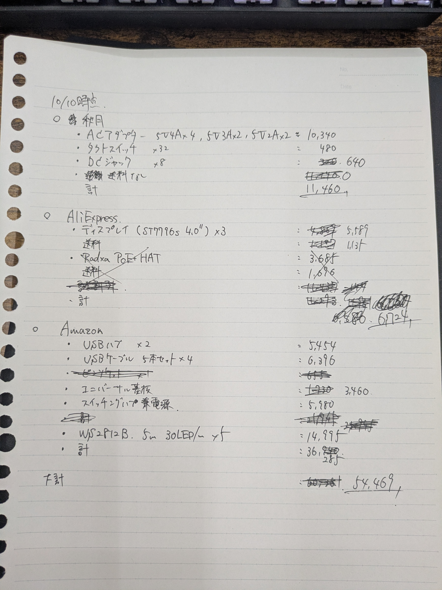

## パケット配送ゲーム(仮)

### デモ
[../demo/network_game_sim.html](../demo/network_game_sim.html)

### ゲームの概要

- TCP/IPのパケット配送からインスピレーションを得たゲーム
- プレイヤーは各ノード上でのパケットの振り分けを担当する
- 振り分けたパケットの数などによってスコアが決まる

### 予算感

### ノード

- サーバーx1
  - 使用候補はROCK 3B
  - 有線LAN通信経由で全体状態を監視するのも余裕があれば欲しい、ノートPCがそのクライアントの候補
- プレイヤーx8
  - ESP32S3
  - ST7796S IPS 4.0in
  - セルフパワーUSBハブによる給電・センターとの通信
- ボットx3
  - ESP32C3
  - パケットバッファ4枠の使用状況が5m先からでもわかるようなLED表示
- ルートx24
  - 通信経路を模したLEDストリップ
  - WS2812B、30LED/m
  - ESP32C3x8を使用して制御

### ルール・その他

詳細は[rules.md](./rules.md)に記入予定

- 外周に8つのプレイヤーノード、内側に3つのボットノード
- 各プレイヤーノードとは2つのボットノードがルートで結ばれている
- 両隣のプレイヤーノード同士もルートで結ばれている
- ボットの処理能力は約1pkt/s
- パケット生成スピードも約1pkt/s予定
- パケットバッファはボットが4pkt、プレイヤーは個数制限なし（画面は先頭3pkt＋退出中1pktを表示）
- バッファが満杯のノードにパケットを送ってしまったプレイヤーはそのパケットをロストし、スコアが減点される
- サイズ感は直径3mぐらい
